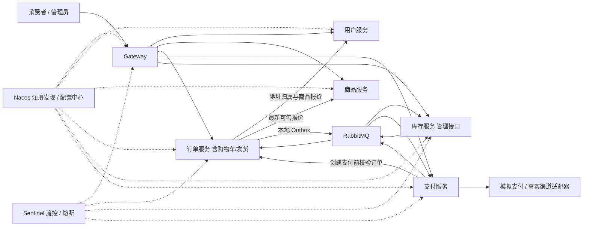

# 技术选型与架构

## 1. 约束与设计结论

按单商家、单仓、人民币、境内地址、固定规格袋装销售设计，支持家庭消费者及小型餐饮客户；第一版使用统一零售价。一个订单最多 20 种 SKU、每 SKU 最多 100 袋，总重量最多 500 kg。大宗采购、特殊地区配送先转人工，不让第一版承担复杂批发结算。

HTTP 对外与服务间调用统一采用 RESTful API + JSON，见接口文档。交易服务使用 Spring MVC + JDBC，本地事务清楚、SQL 可审查；网关单独使用 WebFlux。订单编排使用本地事务、Outbox 事件和补偿形成 Saga。数据库约束和条件更新保证交易正确性，Redis 用于缓存、会话及跨实例防刷，Sentinel 承担流控与熔断。

容量目标是验收假设：在约定的压测环境中，缓存命中读取 2,000 RPS、下单受理 200 RPS，持续 15 分钟。下单受理与库存预占完成分别统计，详见实施文档。未实施和压测前，不宣称这些数字已经达到。

## 2. 技术清单

| 层 | 第一版选型 | 原因及实施约束 |
|---|---|---|
| Java | JDK 21 LTS | 学习与部署统一版本；编译 release=21。虚拟线程后续按压测结果启用，不代替数据库容量控制 |
| 核心框架 | Spring Boot **4.0.8** | 选 Alibaba 官方适配的 Boot 4.0.x；Spring Security、Spring AMQP、Redis、Flyway、驱动等由 Boot BOM 管理 |
| 微服务 | Spring Cloud **2025.1.3** + Spring Cloud Alibaba **2025.1.0.0** | 同时导入 Cloud 与 Alibaba BOM，按官方 2025.1 分支搭建，维护补丁组合须做集成验收 |
| 网关 | Spring Cloud Gateway Server WebFlux + Sentinel Gateway Adapter | 路由、JWT 校验、请求大小限制、Sentinel route/API 分组流控、traceId；不执行商品 SQL |
| 注册发现 | **Nacos Discovery** + Spring Cloud LoadBalancer | 服务从 M0 起注册到 Nacos，网关使用 lb://service-name，多实例通过 LoadBalancer 调用 |
| 同步调用 | Spring HTTP Service Clients + RestClient + LoadBalancer | 声明式接口，连接/读取超时必须配置；有副作用的调用必须具备业务幂等 |
| 流控/熔断 | **Sentinel 1.8.9** | 网关入口、业务方法、依赖调用分别定义稳定资源；流量/热点/并发控制、慢调用与异常熔断；规则持久化到 Nacos |
| 数据访问 | MyBatis Spring Boot Starter **4.0.0** | 官方说明支持 Boot 4.0+；显式 SQL 有利于学习索引、行锁和条件更新 |
| 数据库 | MySQL **8.4 LTS** / InnoDB | 服务分库分账号；本地事务、唯一约束、Flyway 迁移；学习环境允许同一实例承载多个库 |
| 缓存 | Redis **8.2.x** | 缓存、限流、短期认证状态；这是官方 Extended 系列。搭建时固定受维护补丁与镜像摘要 |
| 消息 | RabbitMQ **4.x** + Spring AMQP | 学习版单节点 durable queue；生产版至少三节点 quorum queue。补丁版本搭建时按支持状态固定 |
| 认证 | Spring Security + JWT + 刷新会话 | 用户服务签发非对称 JWT，网关与服务验证公钥；RBAC、对象归属检查、会话撤销 |
| 配置 | **Nacos Config** + 本地启动配置 + 环境变量 | 非秘密运行配置集中管理，spring.config.import 显式加载；namespace 隔离环境；秘密外部注入，不把业务密码写进 Nacos |
| 图片 | 预置图片地址，生产用云对象存储 + CDN | 第一版管理端填受控图片 URL；上传能力后置，不把文件存进交易数据库 |
| 可观测性 | Actuator + Micrometer + OpenTelemetry + Prometheus/Grafana | 指标、JSON 日志、分布式 trace；本地第二阶段加入，交易验收前要能追踪异常 |
| 文档 | 版本化 OpenAPI 3.0.3 | `openapi.json` 为契约；先导入接口工具，不让文档生成组件阻塞框架升级 |
| 测试 | JUnit + Testcontainers + k6 | 重点测真实 MySQL/RabbitMQ 下的并发、重复、乱序、重启；性能测试固定数据和资源 |
| 前端 | Vue 3 + TypeScript + Vite | 消费者与管理员共用工程但路由/权限分开；最终小版本搭建时核对并锁定 |
| HTTP 接口 | **RESTful API + JSON** | 资源/子资源 URI、标准方法与状态码；异步受理返回可查询 Location；身份、幂等、并发版本在契约中定义 |
| 部署 | Docker Compose → 云主机/托管中间件 → 按需 Kubernetes | 学习版一键启动；有容量与运维需求后再引入集群编排 |

版本依据核对于 2026-10-14：Alibaba 2025.1.0.0 的官方发布基线为 Boot 4.0.0 / Cloud 2025.1.0，分支明确适配 Boot 4.0.x / Cloud 2025.1.x，BOM 管理 Nacos Client 3.1.1、Sentinel 1.8.9。方案采用该分支的维护补丁 Boot 4.0.8 / Cloud 2025.1.3；这不是声称官方逐项验证了本项目全部依赖，M0 必须完成启动、发现、配置刷新、Sentinel 和消息集成验证。之前的 Boot 4.1.1 方案不再作为本次基线。[Alibaba 官方版本矩阵](https://sca.aliyun.com/en/docs/2025.x/overview/version-explain/)、[Alibaba 发布说明](https://github.com/alibaba/spring-cloud-alibaba/releases)、[Boot 4.0 系统要求](https://docs.spring.io/spring-boot/4.0/system-requirements.html)、[Cloud 兼容表](https://spring.io/projects/spring-cloud/)。

Nacos Server 固定为 3.2.4，这是核对时官网列出的 GA 版本；客户端仍由 Alibaba BOM 管理为 3.1.1。服务端与客户端不要求数字相同，联调要验证鉴权、发现、配置及 gRPC 连通性，见 [Nacos 发布历史](https://nacos.io/en/download/release-history/)。

MyBatis 4.0 starter 的兼容边界来自[官方要求](https://mybatis.org/spring-boot-starter/mybatis-spring-boot-autoconfigure/)。MySQL 8.4 属于 LTS 系列，Redis 8.2 属于 Extended 系列，分别见 [MySQL 发布模型](https://dev.mysql.com/doc/refman/8.4/en/mysql-releases.html)、[Redis 版本管理](https://redis.io/docs/latest/operate/oss_and_stack/install/version-mgmt/)。这些小版本需要在实际搭建日再次核对安全修复与支持状态。

前端依据 [Vue 3 官方指南](https://vuejs.org/guide/introduction.html) 与 [Vite 搭建指南](https://vite.dev/guide/)；初始化时同时核对 Node.js 要求，提交依赖锁文件。

Nacos 和 Sentinel 是第一版必选基础设施，具体依赖、配置、规则发布与故障处理见 [落地方案](05-Nacos与Sentinel落地方案.md)。第一版不引入 Seata、Elasticsearch、Kafka、分库分表和秒杀库存，先把业务一致性跑通。

## 3. 服务拆分

| 模块 | 开发端口 | 数据库 | 拥有的业务与数据 |
|---|---:|---|---|
| shop-gateway | 8080 | 无 | 外部统一入口、基础鉴权、限流、路由、请求追踪 |
| shop-user | 8081 | flour_user | 用户、角色、登录会话、收货地址；管理员账号通过初始化创建 |
| shop-product | 8082 | flour_product | 分类、SPU、SKU、售价、上架状态、面粉规格与商品报价 |
| shop-inventory | 8083 | flour_inventory | SKU 库存、生产批次、预占单、批次分配、库存流水 |
| shop-order | 8084 | flour_order | 购物车、结算报价、运费规则、订单快照、订单编排、发货与收货 |
| shop-payment | 8085 | flour_payment | 支付控制记录、支付单、回调、关单、补偿退款、渠道对账 |
| Nacos Server（基础设施） | 8848 / 9848；控制台映射 8849 | nacos_config | 注册发现与配置管理；部署在 infra，不是业务 Java 模块 |
| Sentinel Dashboard（基础设施） | 8858 | 规则存 Nacos | 流量监控与规则观察；控制台不是规则持久化数据库 |
| shop-common | 不启动 | 无 | 统一响应、错误码、业务异常、共享 MVC 全局异常处理与 trace 等通用能力；common 自动配置按 MVC 环境注册处理器，不共享各服务 Entity/Mapper |

库名只是物理隔离建议。服务不得直接连接其他服务的库，不用跨库 JOIN；订单保存下单时商品、单价、地址和运费快照。内部 DTO/事件按版本管理，可放小型 `shop-contracts` 模块；避免整个领域模型都依赖一个公共包。

内部 `/internal/v1/**` 路由不在网关注册。开发使用独立服务凭证；生产使用 mTLS 或服务 JWT（audience + scope）和网络隔离，不能相信客户端传来的 X-User-Id。下游仍校验用户 JWT 的签名、有效期、会话和资源归属。

## 4. 高并发与稳定性

**读路径**：商品详情 Redis cache-aside，TTL 5 分钟加随机抖动；空结果缓存约 30 秒；热点加载使用单进程请求合并，必要时使用短 Redis 锁。商品更新后发失效事件，结合 TTL 限制陈旧时间。展示库存允许短暂滞后，购买时由库存服务核验。结算与下单从商品权威写节点读取可售状态和价格，不能使用陈旧展示缓存确认成交。

**写路径**：幂等键和唯一约束；库存本地事务按 SKU 排序更新，批次按有效期分配；订单创建异步预占，返回 202 与可查询的订单资源。热点 SKU 行锁会成为瓶颈，应单独压测；到达瓶颈后可按仓库/SKU 分区消费、设置热点入口配额，再评估库存分桶。不能通过盲目增加实例承诺热点吞吐。

**流控**：Sentinel 网关按 routeId/API 分组控制读取、登录、下单与支付，业务服务按稳定资源名保护关键操作。单实例示例下单阈值 200 次/秒；Sentinel 本地阈值是每实例阈值，多副本不会自动共享。需要严格全局 200 次/秒时，在业务资源 order.create 上启用 Sentinel 集群流控与 Token Server，全局模式设置 200；若仅按两副本各 100 分摊，必须标明这是近似容量分摊。用户每秒 2 次的跨实例防刷可用 Redis 原子计数。流控返回 429 + Retry-After，依赖熔断返回 503，不伪造业务成功。

当预占任务/Outbox 积压条数或最老任务年龄超过配置阈值时暂停受理新订单，返回 503，并继续恢复存量订单；MQ 的队列长度上限不能代替数据库 Outbox 的积压保护。

**资源**：业务服务无状态，多实例；Hikari 单实例先设最大 20 连接，计算所有副本/后台任务总连接数并给 MySQL 预留容量。网关并发、有界线程池、消息 prefetch、队列最大长度都要设置。内部调用连接超时约 300 ms、读取约 1 s 作为起点，端到端按接口预算调整；网关不对下单/支付 POST 自动重试。

**熔断**：Sentinel 保护商品权威报价、地址查询与支付渠道调用，设置慢调用/异常比例和最小样本数。地址或权威报价不可用时返回 503；展示商品可回退短期缓存。支付调用超时保持 UNKNOWN 并查单，不能按 fallback 判断未付款。规则从 Nacos 订阅、发布时审计，应用内拒绝处理器与网关拒绝处理器都返回统一错误格式。WebFlux 资源保护使用网关适配器，不套用 ThreadLocal 的同步写法。

**可恢复**：订单、支付、库存分别保存 Outbox；消费者在自己的本地事务中写业务状态和 `processed_message`，提交后 ACK。Publisher Confirms 配合 mandatory returns；Confirm 成功后才标记已投递。进程在 Confirm 后崩溃可以重复发送，因此消费者必须业务幂等。RabbitMQ 官方也说明连接失败后重发可能造成重复，见[可靠性指南](https://www.rabbitmq.com/docs/reliability)。

**调度**：订单数据库 `expires_at` 扫描是超时关闭的可靠触发源，MQ 延迟机制只是可选加速。多实例用带租约的数据库任务领取/`SKIP LOCKED`，任务本身幂等。库存不根据本地 TTL 单方面释放订单预占。

**消息队列**：交易队列持久化，生产采用 quorum queue；有限指数退避后进死信队列并告警/补偿。需要可靠死信转移时显式配置 `dead-letter-strategy=at-least-once`、`overflow=reject-publish`、有效 DLX 及持久化目标队列；不能把普通 DLX 等同于不丢消息，见 [quorum queue 文档](https://www.rabbitmq.com/docs/quorum-queues)。

## 5. 学习与生产部署

学习环境建议 16 GB 可用内存，业务按需启动；MySQL、Redis、RabbitMQ、Nacos、Sentinel Dashboard 共用 Compose，固定端口只绑定本机。启动顺序：MySQL → Nacos/Redis/RabbitMQ → 发布 Nacos 配置及规则 → Sentinel Dashboard → 业务服务 → 网关 → 前端。Compose 中配置持久化卷、健康检查和环境变量。

生产入口必须 HTTPS；网关与关键业务多副本，负载均衡跨故障域。数据库使用托管高可用或经过演练的主备，Redis 使用高可用部署，RabbitMQ 三节点 quorum queue；商品图片走 CDN。读写分离只用于可接受滞后的展示查询，订单、库存、支付状态校验访问权威写节点。

Nacos 生产采用至少三节点集群与独立配置库账号，客户端/集群端口只在内网开放。Sentinel 本地规则执行不依赖 Dashboard 在线；Nacos 不可用时已加载规则继续使用，但全新实例没有可信规则则不通过就绪探针。需要精确全局限制时，Token Server 故障策略必须明确，交易入口采用拒绝/保守有界降级，不能静默放开全部流量。

每日备份、binlog/PITR、恢复演练、灰度发布与可回滚迁移必须落实。初始目标可设恢复时间 1 小时、数据恢复点不超过 5 分钟，但需用实际备份与故障演练证明；异步主备不能宣称零数据丢失。

监控至少覆盖：接口 P95/P99、错误与限流率、数据库连接/慢 SQL/锁等待、缓存命中率、MQ 积压与最老消息年龄、Outbox 未投递年龄、长时间 PREPARING/CLOSING、支付成功但订单未更新、库存预占滞留、补偿退款失败。
