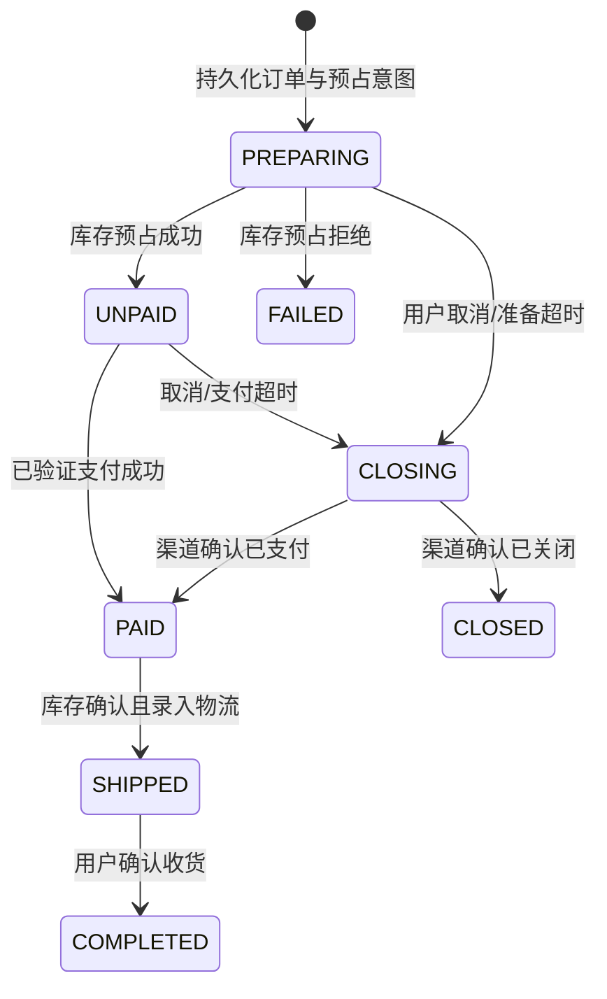

# 业务与数据设计

修订日期：2026-10-14。HTTP 接口采用 RESTful API，Nacos 负责发现/配置、Sentinel 负责流控/熔断；业务正确性仍由本地事务、唯一约束、Outbox 和补偿保证。

## 1. 第一版范围

| 角色 | 必须实现 | 本期不实现 |
|---|---|---|
| 消费者 | 注册、密码登录、刷新/退出、地址维护；分类/商品浏览；购物车；结算/下单；模拟支付；取消未支付订单；订单列表/详情；确认收货 | 短信登录、优惠券、评价、收藏、发票、常规退换货申请 |
| 管理员 | 分类/商品/规格维护；上架下架；按生产批次入库/调整；查看订单；录入物流并发货 | 多商家、ERP/WMS 集成、复杂报表、自动物流追踪 |
| 系统 | 防超卖、业务幂等、异步预占、超时关闭、可靠事件、查单补偿、异常全额退款、审计/告警 | 多仓调拨、散装称重、账期授信、营销秒杀 |

常规退款可以后置，**已收款但订单已关闭的异常全额退款不能省略**。第一版 Mock 也要实现这种补偿；真实渠道接入后同样遵守这个规则。

## 2. 面粉商品与履约规则

### 2.1 SPU、SKU、批次

SPU 代表一类产品，例如“麦香高筋小麦粉”；SKU 代表可购买规格，例如 5 kg/袋、25 kg/袋。同一 SKU 的每袋价格相同，库存单位是整数袋。重量使用整数克，金额使用整数分，ID 在 JSON 中统一为字符串。

商品展示字段：名称、品牌、用途（面包/馒头/面条等）、筋度、配料、储存条件、规格重量、包装、图片、保质期天数。批次字段：batchNo、生产日期、到期日期、仓库、库存、质量状态。日期为业务记录，真实标签与上线资料由经营方核验，不用示例文案直接替代实际商品资料。

第一版仓库为 `WH-SH-01`，批次按 FEFO（最早到期先出）分配；质量状态仅 `SELLABLE`、`BLOCKED`。到期当天起禁止新增预占；过期/冻结批次不得发货。支付后发货再次检查批次，发现质量/有效期问题转人工异常处理，第一版通过告警和禁止发货阻断。

库存服务返回实际分配批次，订单发货记录中保存批次快照，能够由订单追踪到生产批次。购买端只选 SKU，不选择批次。

### 2.2 价格与运费

零售价按 SKU 维护。不支持用户直接提交成交金额。结算返回 quoteId、quoteVersion（服务端报价内容/版本的 SHA-256 摘要）、有效期（5 分钟）和金额明细；报价绑定当前用户、地址、商品/数量及规则版本，只能创建一个订单。客户端保留同一 Idempotency-Key 重试。

下单再次校验报价有效期、地址归属、商品版本/上架状态和权威价格；任一改变返回 `PRICE_CHANGED` / `QUOTE_EXPIRED` / `PRODUCT_UNAVAILABLE`，用户重新结算。报价不锁库存。订单本地提交前若商品发生并发变化，允许以此次权威报价形成不可变订单快照；成交定义为订单服务完成报价复核并持久化的价格，后台调价不追改已受理订单。

第一版演示运费规则 `FREIGHT_V1`：仅支持预置的上海市区县代码白名单，重量大于 0 且不超过 20 kg 收 1,000 分，每超出 20 kg 的 10 kg（不足按一档）加 500 分；总重最多 500 kg。其他地区返回 `DELIVERY_UNSUPPORTED`。支持区域存配置，不能仅靠客户端地址文字判断；这里只是可运行的示例规则，扩大销售范围时替换成实际物流报价。

```text
goodsAmount = Σ(unitPriceFen × quantity)
totalWeightGram = Σ(weightGram × quantity)
freightAmount = 1000 + max(0, ceil((totalWeightGram - 20000) / 10000)) × 500
payableAmount = goodsAmount + freightAmount
```

例：5 kg 高筋面粉单价 3,200 分，2 袋，总重 10,000 g；商品 6,400 分，运费 1,000 分，应付 7,400 分（74 元）。订单无优惠/税额拆分。结算后用户编辑地址不会改变已下单地址快照。

## 3. 核心流程

### 3.1 下单与库存预占

1. 用户登录，维护地址，浏览商品；购物车只保存 SKU 和数量，价格显示重新读取。
2. 调用结算，订单服务读取用户地址、商品可售报价，检查数量/重量/配送区域，持久化 5 分钟报价。
3. 创建订单携带 quoteId + 幂等键。订单服务复核报价，**一个本地事务**以 userId 配额行条件更新占用一个活跃订单名额，再写订单 `PREPARING`、明细/地址/价格快照、幂等记录、已消费 quote 标记和 `InventoryReserveRequested` Outbox，返回 202 + orderNo。不能只先查询 count 再创建，避免并发突破每人 5 单上限；转换为 PAID/CLOSED/FAILED 时在同一本地事务中只归还一次名额。
4. 库存服务消费请求，按 SKU 顺序及 FEFO 分配批次；一个本地事务写预占/批次明细、扣减 available/增加 reserved、消费去重及结果 Outbox。任一 SKU 不足时全部回滚，再单独记录 `REJECTED` 结果。
5. 订单消费 `InventoryReserved`：仅允许 `PREPARING → UNPAID`，在此刻设 expiresAt=当前时间+15 分钟；消费 `InventoryRejected`：`PREPARING → FAILED`，记录失败原因。
6. 消费者查询订单，`UNPAID` 后可以创建支付。购物车清理是可重试的辅助动作，只移除对应已购买数量，不能影响订单成功与否。

订单受理成功只表示创建了持久化意图，不表示有货。前端提示“正在确认库存”，按 1 秒、2 秒、3 秒间隔查询，之后最多每 5 秒查询。PREPARING 超过 30 秒给用户处理中提示；后台超过 2 分钟启动关闭补偿。PREPARING 关闭也要执行释放协议，防止库存已经锁定但结果消息丢失。

### 3.2 支付

1. 用户创建支付，支付服务调用订单内部接口验证归属、`UNPAID`、expiresAt、金额，创建/复用支付控制记录与支付单；参数使用服务端金额。
2. 支付服务每个订单只有一个活动支付，创建意图与关闭意图通过按 orderNo 的本地控制记录串行化。外部渠道调用在本地事务外进行，超时保留 `CREATING/UNKNOWN`，按同一支付号查单，不能更换支付号重复扣款。
3. Mock 返回 dev 页面的支付标识；用户界面不能直接把订单标记为已支付。只有已验证的服务端渠道结果可以落账。
4. 回调先验签/商户/币种/支付号/金额，并记录 callback inbox；同一本地事务将支付置 `SUCCEEDED`、写 `PaymentSucceeded` Outbox，再返回渠道成功 ACK。重复相同结果返回 ACK，不重复记账。
5. 订单消费真实成功事实，把 `UNPAID/CLOSING → PAID`，记录 paymentNo/paidAt，并发 `InventoryConfirmRequested`。库存从 RESERVED 转 CONFIRMED；订单收到 `InventoryConfirmed` 后更新 inventoryStatus。
6. 管理员只有在 `orderStatus=PAID` 且 `inventoryStatus=CONFIRMED` 时才能发货。支付和库存同步尚未完成时显示“支付已确认，准备出库”。

不把“支付成功”立即等同于“发货可执行”。若 Confirm 得到 RELEASED/不存在等异常结果，订单保持异常标记，禁止发货，走查证/异常退款；不能随便把已释放库存重新扣一次。

### 3.3 超时、取消与支付竞争

订单 15 分钟到期后，调度按数据库状态领取任务；用户取消也使用同一个关闭流程：

1. 用户通过 POST cancellations 创建取消申请；在同一本地事务中写 `order_cancellation(PENDING)`、条件更新 `PREPARING/UNPAID → CLOSING`、写关闭原因与 `PaymentCloseRequested` Outbox，返回 202 和申请资源 Location。系统到期使用相同关闭协议，但不伪造用户申请。停止创建新支付。
2. 支付服务建立/锁定 orderNo 的控制记录，设置关闭意图。即使从未创建支付，也保存 **CLOSED 墓碑**，阻止晚到的支付创建请求。
3. 有 CREATING/UNKNOWN 支付时，先完成查单，直到确认所有已发起的渠道意图：已支付则发 `PaymentSucceeded`；未支付则关单并确认不可再支付后发 `PaymentClosed`。网络错误/渠道未知状态时保持 CLOSING，不释放库存。
4. 订单收到成功事实优先转换 PAID，存在用户取消申请时将其标记 REJECTED；收到 PaymentClosed 时仅允许 `CLOSING → CLOSED`，将用户取消申请标记 SUCCEEDED，并写 `InventoryReleaseRequested`。状态、申请结果和 Outbox 必须同一本地事务，PAID 状态不能被关闭消息覆盖。用户 GET 取消申请查询处理结果。
5. 库存幂等释放。若释放先于预占到达，按 orderNo 建立 RELEASED 墓碑；晚到预占不得再占库存。若订单在 CLOSING 收到晚到预占结果，保持 CLOSING，继续原关闭协议。
6. 订单已 CLOSED 却收到有效收款事实：不重新履约，保持 CLOSED，标记 `paymentStatus=REFUNDING`，生成唯一补偿退款请求。全额包括运费，支付服务查证并退款，成功后 `REFUNDED`；失败进入告警和人工处置队列。

到期时间是启动关单的时间，不是凭本地时钟忽略渠道实际收款的理由。在关单确认前渠道可能已经支付，应按渠道结果处理；关单确认后的异常收款必须补偿。

外部支付创建与关单不在一个数据库事务中。控制记录保存 create-in-flight、closeRequested、channelStatus 和重试游标，关闭任务必须等待创建结果可确定，不能因本地“查不到支付记录”就认定渠道没有收款可能。

### 3.4 发货和收货

管理员查看 PAID 订单及批次分配，提交承运商代码/物流单号。订单服务检查库存已确认、批次可发货；本地事务写 shipment、批次快照和 `PAID → SHIPPED`。一个订单第一版只允许一个物流单，不拆包裹。

管理员重复发货请求用幂等键返回原物流单；不同幂等键也受 `shipment(order_no)` 唯一约束约束。消费者仅可对自己的 SHIPPED 订单确认收货，变成 COMPLETED。第一版没有自动收货/物流轨迹。

发货为 POST shipments 创建物流子资源；收货为 PUT receipt 更新单例确认资源，客户端只提交 received=true，服务端写 received_at 与 COMPLETED。重复请求返回原确认时间，不重复改变状态。

第一版是人工物流登记，发货前批次查询与并发质检冻结之间仍有跨服务时间窗。实际生产接 WMS 时，库存服务必须在自己的本地事务中锁定批次、串行化出库授权与冻结并记录出库流水，订单通过可靠事件更新履约状态；不能用一次 GET 可发货查询宣称实物出库具有原子性。当前验收包括已经冻结/过期批次的发货阻断，不包括自动仓储出库。

## 4. 状态机



| 维度 | 状态与约束 |
|---|---|
| orderStatus | PREPARING / UNPAID / CLOSING / PAID / SHIPPED / COMPLETED / CLOSED / FAILED |
| inventoryStatus（订单视图） | PENDING / RESERVED / CONFIRMED / RELEASE_PENDING / RELEASED / REJECTED / EXCEPTION |
| reservationStatus（库存） | RESERVED → CONFIRMED 或 RELEASED；没有预占时允许建立 RELEASED 墓碑；拒绝为 REJECTED |
| paymentStatus（订单视图） | NONE / PENDING / SUCCEEDED / CLOSED / REFUNDING / REFUNDED / EXCEPTION |
| paymentSessionStatus（支付单） | CREATING / PENDING / UNKNOWN / SUCCEEDED / CLOSING / CLOSED；UNKNOWN 必须查单 |
| refundStatus | REQUESTED / PROCESSING / UNKNOWN / SUCCEEDED / FAILED；未知结果先查单再重试 |

CLOSED/FAILED/COMPLETED 为订单终态，补偿支付状态可继续更新。状态变更使用 `UPDATE ... WHERE status IN (...)` 或 version CAS；查询后直接覆盖状态会产生竞争。订单状态和库存/支付状态是独立维度，接口同时返回，便于诊断最终一致过程。

## 5. 防超卖的本地事务

预占以 `(order_no, sku_id)` 幂等。多 SKU 必须在**同一库存服务数据库事务**中全部成功或全部失败；先按 skuId 排序锁聚合，再按 `(expires_on, batch_id)` 锁批次，降低死锁概率。死锁重试次数有界，并使用同一 orderNo。

```sql
-- qty > 0；受影响行数必须为 1。
UPDATE sku_stock
SET available = available - :qty,
    reserved = reserved + :qty,
    version = version + 1
WHERE sku_id = :skuId AND warehouse_id = :warehouseId
  AND available >= :qty;

-- 然后锁定 SELLABLE 且 expires_on > 业务日期的批次，按 FEFO 分配。
-- 每批次同样条件更新 available/reserved。可售批次不足则回滚整个事务。
-- 写 reservation + reservation_item + stock_ledger + result_outbox 后提交。
```

过期扫描会移除批次可用量并同步聚合；即使扫描滞后、聚合包含刚过期的数量，批次过滤和事务回滚也防止实际售出过期批次。可售显示和下单校验以有效批次为准。

Confirm：预占状态 RESERVED → CONFIRMED，批次和 SKU reserved 减少，committed 增加；Release：RESERVED → RELEASED，将仍可售的数量归还 available，已过期/冻结数量转 unavailable。committed 表示已售待发/已发数量，不是仓库实时物理盘点数；后续 WMS 再拆出库实物账。

`available/reserved/committed/unavailable` 都非负；变化必须有流水。Redis 不作为第一版扣库存真相源，不采用简单 Redis 扣减后异步落库来声称不超卖。

## 6. 数据表与约束

所有业务表包含 created_at、updated_at，必要时 version；数据库存 UTC，业务批次日期按 Asia/Shanghai 计算，API 时间返回 ISO 8601 带偏移。数据库 ID 可用 BIGINT 自增，各服务唯一性独立；对外 orderNo/paymentNo 使用 UUIDv7 等可靠唯一生成器，JSON 都是字符串。

| 库 | 表 | 主要字段 / 唯一约束 / 索引 |
|---|---|---|
| user | user_account | id, username, password_hash, nickname, status, token_version；UNIQUE(username)，用户名按 ASCII 不区分大小写判重 |
| user | role | id, role_code, role_name, status, remark；UNIQUE(role_code)，编码区分大小写 |
| user | permission | id, permission_code, permission_name, status；UNIQUE(permission_code)，编码区分大小写 |
| user | user_role | user_id, role_id；联合主键(user_id,role_id)，外键关联本库用户/角色 |
| user | role_permission | role_id, permission_id；联合主键(role_id,permission_id)，外键关联本库角色/权限 |
| user | user_address | id, user_id, receiver, phone, region_code, detail, is_default；INDEX(user_id)；默认地址变更先锁用户行 |
| user | auth_session | id, user_id, refresh_hash, family_id, expires_at, revoked_at；UNIQUE(refresh_hash)；刷新时行锁及原子轮换 |
| product | category | id, name, sort, enabled；第一版一级分类 |
| product | product_spu | id, category_id, name, brand, gluten_type, usage_text, ingredients, storage, shelf_life_days, status, version；INDEX(category_id,status,id) |
| product | product_sku（创建已实现，见 27 文档） | id, product_id, sku_code, spec_name, weight_gram, price_fen, enabled, version, created_at, updated_at；UNIQUE(sku_code，不区分大小写)；INDEX(product_id,enabled,id)；FOREIGN KEY(product_id) 引用 product_spu(id) |
| order | cart_item | user_id, sku_id, quantity；UNIQUE(user_id,sku_id)；PUT 使用绝对数量避免重复累加 |
| order | user_order_quota | user_id, active_count, version；UNIQUE(user_id)；条件增加 active_count<5，订单状态迁移时幂等归还 |
| order | checkout_quote | quote_id, user_id, address_snapshot, item_snapshot, goods/freight/payable_fen, total_weight_gram, price_hash, expires_at, consumed_order_no；UNIQUE(quote_id) |
| order | order_main | order_no, user_id, quote_id, idempotency_key, request_hash, 三种状态, amounts, address_snapshot, expires_at, payment_no, failure_code, version；UNIQUE(order_no), UNIQUE(user_id,idempotency_key), UNIQUE(quote_id)；INDEX(user_id,created_at,id)、INDEX(status,expires_at) |
| order | order_item | order_no, sku_id, spu_name, sku_spec, unit_price_fen, quantity, weight_gram；UNIQUE(order_no,sku_id) |
| order | order_cancellation | cancellation_no, order_no, user_id, reason, status, requested_at, completed_at, failure_code；UNIQUE(cancellation_no), UNIQUE(order_no)；绑定幂等键，状态与订单事务内更新 |
| order | shipment | order_no, carrier_code, tracking_no, batch_snapshot, shipped_at；UNIQUE(order_no) |
| inventory | sku_stock | sku_id, warehouse_id, available, reserved, committed, unavailable, version；UNIQUE(sku_id,warehouse_id) |
| inventory | stock_batch | batch_id, sku_id, warehouse_id, batch_no, manufactured_on, expires_on, quality_status, 四种数量；UNIQUE(sku_id,warehouse_id,batch_no)；INDEX(sku_id,warehouse_id,quality_status,expires_on,batch_id) |
| inventory | inventory_reservation | order_no, state, request_hash, failure_code；UNIQUE(order_no)；不存在时的释放也必须建立记录 |
| inventory | reservation_item | order_no, sku_id, batch_id, quantity；UNIQUE(order_no,sku_id,batch_id) |
| inventory | stock_ledger | operation_no, order_no nullable, batch_id, reason, delta, before/after, actor；UNIQUE(operation_no,batch_id,reason) |
| payment | payment_control | order_no, user_id, amount_fen, currency, state, close_requested, create_in_flight, version；UNIQUE(order_no)；无支付时也能建立关闭墓碑 |
| payment | payment_session | payment_no, order_no, provider, provider_transaction_no, amount_fen, status, expires_at；UNIQUE(payment_no), UNIQUE(order_no,provider), UNIQUE(provider,provider_transaction_no) |
| payment | callback_inbox | provider, provider_event_id, payload_hash, processing_result；UNIQUE(provider,provider_event_id) |
| payment（dev/test） | mock_provider_event | event_id, payment_no, type, created_at, callback_delivery_state；UNIQUE(event_id)；与测试事件幂等键绑定，通过可靠重投驱动签名回调 |
| payment | refund_order | refund_no, order_no, payment_no, amount_fen, reason, status, provider_refund_no；UNIQUE(refund_no), UNIQUE(payment_no,reason) |
| 各写服务 | outbox_event | event_id, aggregate_id, aggregate_version, type, payload, status, attempts, next_retry_at, lease_until；UNIQUE(event_id)；INDEX(status,next_retry_at,id) |
| 各消费服务 | processed_message | consumer_name, event_id, processed_at；UNIQUE(consumer_name,event_id) |
| 各写服务 | idempotency_record | principal_id, method, route, key, request_hash, resource_id, result；UNIQUE(principal_id,method,route,key)；订单另由 order_main 永久绑定 |
| 各管理服务 | audit_log | actor_id, action, resource_id, trace_id, time, 脱敏前后值；INDEX(resource_id,time) |

金额字段 BIGINT 并设合理上限，数量 INT + 非负约束；关键引用在同库可建外键，跨服务只存 ID，不建立跨库约束。幂等请求 hash 包含规范化请求内容，排除 traceId；相同 key 不同内容返回冲突。

Outbox 领取时先在短事务中记录租约，再在事务外发 MQ，处理 Confirm/Return 后更新状态；租约到期可重新领取。不能在数据库行锁里等待网络调用。业务幂等记录/墓碑保留时间必须覆盖消息重投、补偿与历史回放窗口；第一版不清理订单绑定和库存墓碑，生产再设计归档策略。order_main 增加 received_at 表示 receipt 子资源，auth_session 的 id 即接口 sessionId。

## 7. 补偿与安全边界

| 异常 | 自动恢复策略 | 用户可见行为 |
|---|---|---|
| 订单事务提交但 MQ 暂停 | Outbox 重试，PREPARING 超阈值按关闭协议补偿 | 正在确认库存，可查询/取消 |
| 库存锁定但结果未送到 | 库存结果 Outbox 重发；订单对账查询 reservation | 保持 PREPARING，不重复扣库 |
| 关闭消息先于预占 | 支付 CLOSED 与库存 RELEASED 墓碑分别阻挡晚到创建 | 最终 CLOSED，不产生悬挂预占 |
| 已收款但成功事件未送到 | 支付 Outbox、周期查单与订单对账 | 保持处理中，禁止重复扣款 |
| 订单已关闭后确认收款 | 唯一全额退款请求、查退款单、告警 | CLOSED + REFUNDING/REFUNDED |
| Confirm 失败或批次异常 | 禁止发货，查证/退款补偿并告警 | PAID + EXCEPTION，不伪造发货 |
| 支付渠道失联 | 关单保持 CLOSING，重试查单；库存保留 | 关闭处理中 |
| Redis 缓存故障 | 商品有界回源；缓存/认证 Redis 用独立配额与内存策略 | 可降级展示；限流/撤销状态无法核验时拒绝敏感请求 |
| Nacos 不可用 | 已启动实例使用最近有效配置和注册缓存；新实例缺少关键配置/规则不就绪；恢复后核验发现列表 | 不能发现可用依赖时 503，持久化订单继续补偿 |
| Sentinel 触发保护 | 入口流控 429；依赖熔断 503；MQ 消费有界退避、不提前 ACK；Dashboard 故障不影响本地规则 | 明确失败/处理中，不把未知支付降级为成功或未支付 |

密码使用 Spring Security BCrypt 等合适的慢哈希，禁止明文；登录限流，错误提示不泄露账号是否存在。JWT 验证 issuer/audience/签名/时间，访问令牌 15 分钟，refresh 7 天且只存 hash、轮换并检测重用。

访问令牌携带 sid/tokenVersion；网关和业务服务检查会话撤销状态。退出撤销整个当前会话，不能只删除客户端 token。撤销更新数据库与缓存，缓存短 TTL 控制传播窗口；若强制要求立即生效，撤销确认前必须完成共享状态更新，故障时敏感请求查询权威会话或返回 503，不放行。生产浏览器 refresh 走 Secure/HttpOnly/SameSite cookie 并配套 CSRF 防护；第一版接口调试模式返回 JSON token，由客户端自行保护。

角色只有 USER/ADMIN，注册只能产生 USER，管理员由初始化脚本创建。查看地址/订单/支付单必须检查资源归属，管理员跨用户查询使用独立管理接口并审计。公共回调按渠道认证，与登录鉴权分开；Mock 的成功触发接口仅 dev/test 环境 + ADMIN 可用。

日志不得输出密码、token、完整手机号/地址或回调秘密；公网不暴露数据库、注册中心、内部接口和管理监控端点。配置秘密外部注入，权限变更、出入库、发货和补偿退款记录审计。
