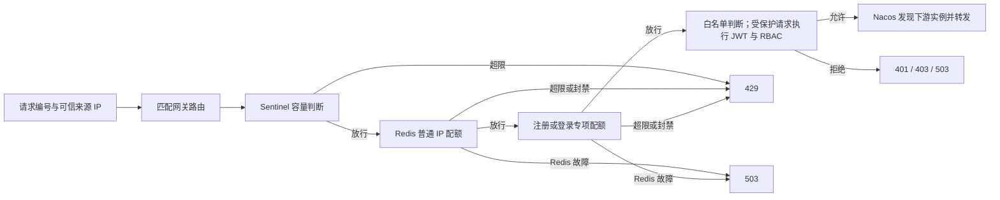

# 网关限流与 Redis 防刷：方案、代码与验收

日期：2026-10-17。当前实现基于 JDK 17、Boot 3.2.5、Cloud 2023.0.1、Sentinel 1.8.6，Redis 使用官方镜像 `redis:8.2.10-alpine`。本次保留现有父子 POM、业务路由及 YAML 文件位置，Redis Compose 由网关模块拥有。

2026-10-18 POM 继承结构已按新要求调整，网关改为继承基础父 POM 隔离默认数据库依赖；当前结构见 [POM 继承与依赖管理说明](13-POM继承与依赖管理说明.md)。本文的请求保护逻辑与配置位置继续适用。

同日网关 Compose 已拆分为安全 Redis（6380，沿用原防刷实例）与业务缓存 Redis（6381）。本篇防刷代码继续连接 6380，连接参数和职责见 [双 Redis 说明](14-Docker双Redis实例与连接说明.md)。

专项策略现已改为 policies 规则表，过滤器通过策略解析接口获取执行计划，不再按注册/登录写 if/else；扩展方式见 [配置驱动防刷策略设计](15-配置驱动防刷策略设计.md)。

认证鉴权继续在 Redis 防刷之后执行；权限读取现采用 Redis + OpenFeign 冷加载，无 Caffeine 或权限广播，当前实现及验收见 [17 文档](17-Redis权限冷加载与OpenFeign.md)。

## 1. 实现方案

| 层次 | 组件与范围 | 默认阈值 | 超限行为 |
|---|---|---|---|
| 容量保护 | Sentinel，单个网关实例所有匹配路由共用 `gateway.capacity` API 分组 | 200 QPS | HTTP 429 / RATE_LIMITED |
| 普通防刷 | Redis，所有匹配路由按来源 IP 共用额度 | 滚动 60 秒 120 次 | HTTP 429 / ABUSE_LIMITED |
| 注册防刷 | Redis，POST /api/v1/users 按 IP 独立额度 | 滚动 60 秒 5 次 | 同上 |
| 登录防刷 | Redis，POST /api/v1/auth/sessions 按 IP 独立额度 | 滚动 60 秒 10 次 | 同上；登录业务接口本身尚未实现 |
| 临时封禁 | Redis，每个“策略 + IP”独立记录超限 | 窗口内连续超限 3 次 | 该策略封禁 5 分钟 |
| 保护依赖故障 | Redis 出错或检查超时 | 单项检查超时 1 秒 | HTTP 503 / DEPENDENCY_UNAVAILABLE，停止转发 |

阈值为本地开发起点，需要根据 CPU、连接池、业务耗时和压测调整。Sentinel 200 QPS 是每实例限制；部署三个实例不会自动变成全局 200 QPS。Redis 中的 IP 额度由所有使用同一 Redis、数据库和 key-prefix 的网关实例共享。严格全局容量限制需要另行接入 Sentinel 集群流控。



## 2. 防刷规则的具体语义

- 所有专项额度都检查通过才转发。注册的第六次请求即使能通过普通额度，也会被注册额度拒绝。
- 计数发生在转发前，失败注册、非法参数、重复用户名等请求也消耗额度。不会读取或缓存密码请求体。
- 一次正常放行会清除该策略的连续违规计数；连续违规在本窗口内累计。注册封禁只封禁注册策略，普通读取仍可使用普通额度；普通额度触发封禁时，所有匹配路由都受限。
- 全局额度在专项额度之前消费。专项拒绝的请求仍计入普通访问频率，避免持续被拒绝的注册请求无限冲击 Redis。
- 注册路径、`/shop-user/api/v1/users` 自动发现路径、一次 URL 编码后的等价路径以及尾部斜杠，共用注册额度。Redis Key 不含原始 URL、查询参数或明文 IP，不能通过随机 query 制造独立配额。
- 非 POST 请求不占用注册/登录专项额度，但仍占普通额度。未匹配任何网关路由的 404 请求不进入 GlobalFilter；本功能不替代边缘连接数防护。

Redis Lua 在服务端原子执行：先检查封禁，再用 Redis TIME 取得时间，移除窗口外事件，判断数量，然后写入放行事件或记录违规/封禁。事件集合最多保存该策略允许的事件数量，重复被拒绝的请求不会无限增加集合成员。事件、违规计数、封禁都有过期时间。三个 Key 通过 `{摘要}` 使用同一 Redis Cluster slot，脚本本身支持同槽原子操作；当前开发部署为单个 Redis。

Redis 使用 AOF 和 `noeviction`，防止内存不足时悄悄淘汰计数导致放开额度。内存不足、网络故障或脚本异常会走 503。Redis 恢复后请求可以继续检查；不会在请求线程中阻塞等待或使用 JVM 本地计数冒充共享额度。

超时按每项策略检查计算；注册和登录会依次执行普通及专项两项检查，不把配置的 1 秒解释为整个 HTTP 请求的总时限。

## 3. 来源 IP 与响应

`server.forward-headers-strategy=none`，默认使用 TCP 连接的来源 IP。客户端伪造 `Forwarded`、`X-Forwarded-For`、`X-Real-IP` 不会改变额度。

有反向代理时，在 `gateway.protection.trusted-proxies` 中填写自己管理的代理 IP/CIDR，例如 `10.20.0.0/24`。只有连接对端在白名单中，才从 X-Forwarded-For 的右侧逐跳移除可信代理，停在第一个不可信来源；不直接相信最左侧 IP。非法或过长的代理头回退为连接对端。代理本身也必须清洗外部传入的头，不能将所有地址列为可信。部署时应限制业务服务只接受网关/内部调用，防止绕开网关直连业务端口。

同一个公网出口下的多人共享 IP 配额。JWT 与 RBAC 已在防刷之后执行，见 [认证鉴权说明](16-网关JWT与动态RBAC实现.md)；前置防刷仍只使用可信 IP，不使用外部用户 ID 头。验证码、设备风险识别和边缘防护可继续扩展，本版实现访问频率及短时封禁，不声称能识别所有机器人或阻止分布式换 IP 攻击。

所有保护与认证鉴权拒绝响应复用 common 的 `Result`，使用 `code/message/data/traceId`，没有把 MVC 异常处理器装进 WebFlux 网关。网关单独处理响应式异常，POM 排除 common 的 Web MVC，并通过基础父 POM 隔离数据库依赖。入口每次生成新 UUID，不沿用客户端 X-Request-Id；同一个 traceId 写入 attributes、下游请求和响应头。响应提交前恢复入口 ID，避免下游同名响应头覆盖。响应式代码不依赖跨线程 MDC。

```http
HTTP/1.1 429 Too Many Requests
Content-Type: application/json
Retry-After: 57
X-Request-Id: 9f6e7e97-fef2-4770-8d8e-482b019b5c78
```

```json
{
  "code": "ABUSE_LIMITED",
  "message": "操作过于频繁，请稍后重试",
  "data": null,
  "traceId": "9f6e7e97-fef2-4770-8d8e-482b019b5c78"
}
```

Redis 的 Retry-After 根据窗口或封禁的实际剩余时间向上取整；Sentinel 使用 1 秒重试提示，不承诺 1 秒后一定有容量。Redis 故障返回 503 和通用提示，不向客户端泄露地址、密码或堆栈。

## 4. 代码阅读顺序

逐步解释字段和每段代码的配套教程见 [网关代码流程阅读说明书](12-网关代码流程阅读说明书.md)。

| 文件（相对 shop-gateway） | 内容 |
|---|---|
| `src/main/resources/application.yml` | 规则阈值、Redis 地址、可信代理、控制台地址 |
| `compose.yaml` | 本机 Redis、健康检查、持久化及端口映射 |
| `config/ProtectionProperties.java`（Java 包下） | 类型化配置与参数校验 |
| `web/GatewayRequestFilter.java` | 请求编号、IP 提取、下游转发头清洗 |
| `web/ClientIpResolver.java` | 可信代理链解析，支持 IPv4/IPv6 |
| `config/SentinelGatewayConfig.java` | 正确包名、网关过滤器、API 分组规则和 429 回调 |
| `protection/AbusePolicyResolver.java` | 策略解析接口，将请求转换为执行计划 |
| `protection/ConfiguredAbusePolicyResolver.java` | 编译配置规则、按方法/路径/路由匹配，无固定服务名单 |
| `protection/AbusePolicy.java` | 传给执行器的策略名称与额度 |
| `protection/AntiAbuseFilter.java` | 委托解析器、顺序执行、拒绝或故障响应 |
| `protection/RedisAbuseLimiter.java` | 响应式 Redis Lua 调用与共享 Key |
| `src/main/resources/redis/anti-abuse.lua` | 原子滑动窗口、违规计数与临时封禁 |
| `web/GatewayResponses.java` | 使用 common Result 写出 WebFlux 响应 |

Java 文件位于 `src/main/java/org/spring/shopgateway/`。修复了原 `SentinelGatewayConfig` 包名为 `com.dong.gateway.config`、不在启动类扫描范围内的问题；还注册了原先缺失的 SentinelGatewayFilter 和异常处理器。普通 Servlet URL filter 关闭，容量分组使用 `/**` 的 Ant 匹配，包含静态和自动发现路由。

规则配置类显式依赖 Alibaba 的 SentinelAutoConfiguration，先将 Spring 配置写入 Sentinel，再首次加载原生规则管理器。原生配置会在首次使用时缓存；顺序反过来会出现限流能工作、控制台地址却被缓存为空的情况。正式联调已确认修正后控制台能收到应用心跳，应用类型为网关。

当前 Sentinel 默认规则保存在本地 YAML，由代码在启动时加载，重启后恢复默认值。控制台可以观察并调整运行时网关规则，资源选择自定义 API `gateway.capacity`，但控制台临时修改不会自动写回 YAML，也没有接入 Nacos 动态规则源。生产集中规则发布、审批和持久化仍按 05 文档后续接入，不能把控制台可见当作持久化完成。

## 5. IDEA 启动与调整配置

1. 打开 Docker Desktop，保持 Nacos 和 Sentinel 控制台可用。
2. Maven 重新加载项目。
3. 网关运行配置的工作目录为 `$PROJECT_DIR$/shop-gateway`，本次已补入已有 IDEA 运行配置。
4. 启动用户等业务服务后，重启网关。网关会通过模块自己的 Compose 启动 Redis，默认连接 `127.0.0.1:6380`，网关仍监听 `8888`。
5. 访问 `http://localhost:8858/` 观察网关流量；访问网关接口后才会产生 Sentinel 资源数据。

| 环境变量 | 默认值/含义 |
|---|---|
| SHOP_GATEWAY_REDIS_HOST | 127.0.0.1 |
| SHOP_GATEWAY_REDIS_PORT | 6380；同时控制本地 Compose 映射 |
| SHOP_GATEWAY_REDIS_PASSWORD | shop_gateway_local_dev；仅本地开发默认值 |
| SHOP_GATEWAY_COMPOSE_ENABLED | true；外部托管 Redis 时设为 false |
| SHOP_GATEWAY_COMPOSE_FILE | compose.yaml；从其他工作目录启动时提供明确路径 |

Compose 使用 `org.springframework.boot.ignore=true` 关闭 Redis 自动连接参数推导，显式采用 application.yml 的地址和密码，避免 requirepass 与自动生成的无密码连接冲突；该标签不阻止 Compose 启动容器。本地端口只绑定回环地址。正式部署改用平台提供的 Redis、密码/ACL、TLS 及可用性配置。

阈值可直接修改 `gateway.protection`，然后重启。单独关闭防刷可设 `gateway.protection.anti-abuse.enabled=false`；这不自动关闭 Compose，也不关闭 Sentinel。所有实例必须保持相同策略参数和 key-prefix，发布规则变更时应协调生效时间。

## 6. 验证与请求示例

Maven 执行 `-pl shop-gateway -am test`，先启动本地 Redis。测试通过随机前缀隔离数据，只清理自己的 Key，不清空共享 Redis。测试关闭 Compose 自动启动、Nacos 和控制台连接，仍然运行实际 Sentinel 及实际 Redis Lua；因此 Redis 需要先由 `docker compose -f shop-gateway/compose.yaml up -d --wait` 启动。

2026-10-17 阶段验收共 19 项（gateway 18，common 1）；后续入口与认证回归的最新完整结果见 [16 文档验证记录](16-网关JWT与动态RBAC实现.md#11-验证记录)：

- 两个限流器共享 Redis，40 个并发请求、额度为 5 时恰好放行 5 个。
- 注册普通路径、服务名前缀、编码路径共用额度，伪造 IP 头不能增加次数。
- 普通配额、登录专项配额、封禁和过期恢复；Key TTL 与事件数量边界。
- Sentinel 真实 HTTP 拦截，静态/自动发现入口共用容量，被拒绝请求不进入下游。
- Redis 无法连接时真实 HTTP 返回 503，被拒绝请求不进入下游，响应不泄露内部信息。
- 可信代理链、非法代理配置、IPv6、请求编号和现有业务路由。

正式配置联调另使用独立端口 `18889` 和独立 Redis Key 前缀，没有停止用户的 IDE 网关：Compose 配置被正确读取，实例注册到真实 Nacos，并通过真实 user 服务验证 8 次空注册请求的响应为 `400,400,400,400,400,429,429,429`，最后一次 Retry-After 为 300 秒；没有创建账号。Sentinel 控制台收到 `gateway-protection-check` 的心跳，应用类型为 1。联调结束后，独立网关及其 Redis Key 已清理，Redis 容器保留运行，原 IDE 网关需要重启后才使用新代码。

`shop-gateway/requests/gateway-protection.http` 提供请求示例。用空 JSON 测试注册保护时，下游会先返回 400，因为字段校验失败；这类请求也计数。新窗口内前 5 次通过防刷，第 6 次起返回 429，连续超限第 3 次触发注册策略 5 分钟封禁。请按 Retry-After 等待；不会在示例中执行 Redis 全库清理。

## 7. 按代码追踪流量拦截全流程

以同一个 IP 请求 `POST http://localhost:8888/api/v1/users` 为例。

### 7.1 启动时准备

1. 读取网关 application.yml，通过网关自己的 Compose 文件启动或复用 Redis；创建配置 Bean 时绑定并校验 ProtectionProperties。
2. Alibaba SentinelAutoConfiguration 先设置应用名、控制台地址和客户端通信端口。
3. SentinelGatewayConfig.initialize() 加载 `gateway.capacity` 自定义 API 分组及默认 200 QPS 规则，并注册限流回调。
4. Spring 创建入口 WebFilter、Sentinel GlobalFilter、Redis 防刷 GlobalFilter、JWT/RBAC GlobalFilter，以及 Sentinel 异常处理器。Nacos 客户端维护服务发现信息，供网关负载均衡使用。

Sentinel 的拦截决定在网关进程中执行，不会每个请求都交给控制台判断。控制台负责观察与管理规则；Nacos 负责服务发现，正常情况下也不是每个 HTTP 请求都临时查询一次远端 Nacos。

### 7.2 请求进入：确定请求编号和可信 IP

`GatewayRequestFilter.filter()` 是 WebFilter，order 为 -2000，在进入网关路由处理之前执行：

- 无论客户端是否提交 X-Request-Id，均生成新 UUID；后续步骤不重复生成。
- ClientIpResolver.resolve() 默认取连接来源 IP；仅对可信代理按规则解析 X-Forwarded-For。
- 把 traceId、clientIp 存入当前 ServerWebExchange 的 attributes，后续步骤使用同一份结果。
- 删除外部身份头及代理头，再写入可信 X-Forwarded-For 和入口 X-Request-Id；保留 Authorization、正常业务头及请求体。
- 预设响应 X-Request-Id，并在提交前恢复为同一个入口编号；429、401、403、503 等拒绝响应也携带它。

这些操作不读取注册密码，也不使用 ThreadLocal 保存响应式请求状态。

### 7.3 匹配路由

Gateway 根据 Path 等 predicates 选择路由。本例匹配 `shop-user-api`，目标为 `lb://shop-user`。

自动发现入口 `/shop-user/api/v1/users` 会匹配其发现路由。它的服务名前缀由后续路由过滤器移除；防刷判断在此之前会先计算逻辑路径，因此两个入口不会获得两份注册额度。

没有路由匹配时，返回网关 404，不进入 Sentinel/Redis 的 GlobalFilter 链。入口 WebFilter 已执行，因此仍可以带请求编号。

### 7.4 Sentinel 容量检查

`SentinelGatewayFilter` 在匹配路由后的 GlobalFilter 链中 order 为 -200，Redis AntiAbuseFilter 的 order 为 -100，因此先经过容量检查。

每个网关实例的所有匹配路由都进入同一个 `gateway.capacity` 分组，默认上限为 200 QPS，不按 IP 区分，也不是给每个服务各 200 QPS。

- 通过：继续 Redis 检查。
- 超限：Sentinel 产生拦截异常，由 SentinelGatewayBlockExceptionHandler 交给已注册的回调，返回 429 / RATE_LIMITED / Retry-After: 1。
- Sentinel 拒绝时不执行 Redis Lua，不累计 Redis 的违规次数，也不调用业务服务。

WebFilter 与 GlobalFilter 是不同层次的链，不能把三个 order 数字理解成三个同类型过滤器。AntiAbuseFilter 使用 Mono.defer，把 Redis 操作推迟到订阅执行，避免 Sentinel 在构建后续链时就提前发生 Redis 副作用。

### 7.5 Redis：先检查普通额度，再检查专项额度

`AntiAbuseFilter.filter()` 取入口已经确认的 IP，委托 `AbusePolicyResolver` 按配置生成有序策略列表：

| 请求 | 依次执行的策略 |
|---|---|
| POST /api/v1/users | all：120 次/60 秒 → register：5 次/60 秒 |
| POST /api/v1/auth/sessions | all：120 次/60 秒 → login：10 次/60 秒 |
| 其他匹配路由的请求 | all：120 次/60 秒 |

配置解析器使用 PathContainer 分段解码一次并处理矩阵参数，从实际 lb 路由推导并移除服务名前缀，去掉尾斜杠，再用启动时编译的 PathPattern 匹配。规则同时支持方法和 route-ids 条件。该过程只用于选择防刷策略，实际转发路径仍由原有路由过滤器决定。

concatMap 顺序执行策略；任意策略拒绝就停止剩余检查。普通额度通过、专项额度拒绝时，普通额度已经消费，不做回退。

RedisAbuseLimiter.check() 为“策略 + IP”计算 SHA-256 摘要，并调用 anti-abuse.lua。每项策略使用三个同槽 Key：

| Key 后缀 | Redis 类型 | 保存内容 |
|---|---|---|
| :events | ZSET | 放行事件的唯一标识与 Redis 时间戳 |
| :violations | String | 当前窗口的连续超限计数 |
| :ban | String | 封禁标志，剩余 TTL 即封禁剩余时间 |

Lua 的判断顺序为：

```text
已有未过期封禁？
  是 → 拒绝，返回封禁剩余时间
  否 → 读取 Redis 时间，清除滑动窗口之外的放行事件
        当前事件数达到额度？
          否 → 添加本次放行事件，设置过期时间，清除连续违规计数，放行
          是 → 连续违规计数加一，首次违规设置计数过期时间
                达到 3 次？
                  是 → 写入 5 分钟封禁，清除违规计数，拒绝
                  否 → 按最早事件计算配额恢复时间，拒绝
```

每一次 Lua 执行是原子的，两个网关同时检查同一个“策略 + IP”不会各自放行一份额度；普通与专项两次脚本之间不是一个事务，前一次消费不会因后一次失败而回滚。

Redis 拒绝返回 429 / ABUSE_LIMITED，Retry-After 按剩余窗口或封禁时间向上取整。连接异常、脚本错误、空结果或单项超时返回 503 / DEPENDENCY_UNAVAILABLE，并停止转发。onErrorResume 只包围 Redis 决策部分，不把后续业务服务的错误改写成 Redis 故障。

### 7.6 放行：选择下游并处理业务

防刷通过后调用 chain.filter(exchange)，先进入 order=-50 的认证鉴权过滤器。注册 POST 白名单清理身份头后匿名放行；其他受保护请求必须通过 JWT 验签与 RBAC，才写入验证所得的 X-User-Id。之后才进入路径重写、负载均衡和网络转发，不注入角色或权限头。

网关根据 `lb://shop-user`，使用 Nacos 服务发现信息和 LoadBalancer 选择健康的用户实例，将请求发往其 HTTP 端口，例如 8081。此时才进入 UserController 的参数校验以及后续注册、密码哈希、数据库事务。

业务校验失败不会退回已消费的访问额度：空请求返回 400、用户名重复返回 409，也都算注册尝试。如果没有可用下游实例，网关还可能产生自己的转发错误；应区分它和保护层返回的 DEPENDENCY_UNAVAILABLE。当前统一 Result 专门覆盖本次容量/防刷拒绝分支，不能据此认为所有网关异常都已经统一包装。

### 7.7 响应返回

- 正常放行：下游业务响应经过网关返回，保留其业务状态码和内容。
- Sentinel 拒绝：限流回调构造 common Result，由 Sentinel 异常处理器写出。
- Redis 拒绝或故障：GatewayResponses.reject() 用 common Result 序列化 JSON 并写出。
- 所有保护分支携带入口 traceId，响应头与响应体可关联；拒绝后不会再执行下游业务。

同一 IP、同一滚动窗口、没有其他流量干扰时，注册示例如下：

| 第几次请求 | 注册策略结果 | 是否进入 user |
|---|---|---|
| 1～5 | 放行并计数 | 是；是否合法由 user 判断 |
| 6 | 第一次超限，429 | 否 |
| 7 | 第二次超限，429 | 否 |
| 8 | 第三次超限，封禁 5 分钟，429 | 否 |
| 封禁期间继续注册 | 直接按封禁 TTL 拒绝 | 否；不延长已有封禁 |
| 封禁和窗口过期后 | 重新判断额度 | 条件满足时是 |

注册策略封禁期间，如果普通策略没有超限，商品读取等请求仍可以通过普通额度。直接访问 user 的 8081 端口不会经过以上网关保护，部署时应通过网络访问控制限制这种绕行。

参考：[Sentinel 网关流控](https://sentinelguard.io/zh-cn/docs/gateway-flow-control.html)、[Redis Lua](https://redis.io/docs/latest/commands/eval/)、[官方 Redis 镜像版本](https://github.com/docker-library/official-images/blob/master/library/redis)。
