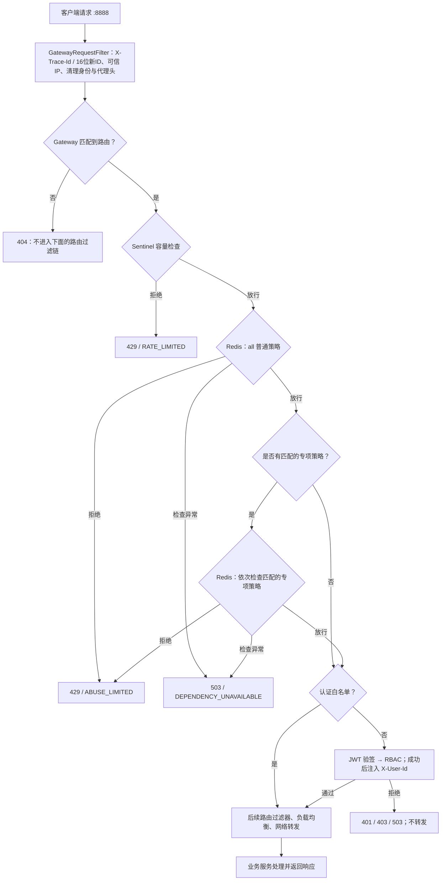

# 网关代码流程阅读说明书

2026-10-20：认证过滤器已委托 GatewayAccessService/PermissionAuthorizer，异常出口统一为 GatewayErrorWebExceptionHandler，纯权限比较位于 RbacPolicyEvaluator；过滤层次和防刷顺序不变，当前职责说明见 [19 文档](19-网关职责重构与生产治理.md)。

本文对应当前 `shop-gateway` 代码，以 `POST http://localhost:8888/api/v1/users` 为主线。目标是能回答：请求经过哪里、每个字段保存什么、每一步为什么执行、在哪一步返回响应。

2026-10-18 Redis 已拆成两个实例：本篇防刷流程使用 6380 安全实例，6381 用于业务缓存；配置与连接参数见 [双 Redis 说明](14-Docker双Redis实例与连接说明.md)。

同日策略选择已改为配置驱动：过滤器委托 AbusePolicyResolver 选择规则，新增接口修改 policies 配置即可。设计、字段与迁移方法见 [配置驱动防刷策略设计](15-配置驱动防刷策略设计.md)。

2026-10-19 已在 Redis 防刷之后新增 order=-50 的 JWT/RBAC 过滤器，注册接口属于 POST 白名单。当前权限实现为 Redis + OpenFeign 冷加载，已移除 Caffeine/广播；认证鉴权执行分支见 [当前权限流程](17-Redis权限冷加载与OpenFeign.md)。

文中的默认值来自当前配置；如果你修改了配置或在 Sentinel 控制台调整了运行规则，应以实际生效值为准。双 Token 登录已实现，见 [20 文档](20-双Token登录刷新与JJWT.md)。2026-10-22 已统一 X-Trace-Id、Reactor/MDC、Feign 和异步传播，见 [21 文档](21-全链路TraceId与异步上下文.md)。

## 1. 先打开这些文件

Java 文件均位于 `shop-gateway/src/main/java/org/spring/shopgateway/`。建议第一次阅读按下表顺序打开，后续按第 4～12 节跟踪一次请求。

| 顺序 | 文件 | 先弄懂的问题 |
|---|---|---|
| 1 | [application.yml](../shop-gateway/src/main/resources/application.yml) | 监听哪个端口、转发到哪里、阈值是多少？ |
| 2 | [ShopGatewayApplication.java](../shop-gateway/src/main/java/org/spring/shopgateway/ShopGatewayApplication.java) | 应用从哪里启动、哪些包会被扫描？ |
| 3 | [ProtectionProperties.java](../shop-gateway/src/main/java/org/spring/shopgateway/config/ProtectionProperties.java) | YAML 如何变成 Java 配置对象？ |
| 4 | [GatewayRequestFilter.java](../shop-gateway/src/main/java/org/spring/shopgateway/web/GatewayRequestFilter.java) | 如何设置请求编号和来源 IP？ |
| 5 | [ClientIpResolver.java](../shop-gateway/src/main/java/org/spring/shopgateway/web/ClientIpResolver.java) | 为什么不能直接相信客户端传来的 IP？ |
| 6 | [SentinelGatewayConfig.java](../shop-gateway/src/main/java/org/spring/shopgateway/config/SentinelGatewayConfig.java) | 容量规则如何加载、超限怎么返回？ |
| 7 | [AntiAbuseFilter.java](../shop-gateway/src/main/java/org/spring/shopgateway/protection/AntiAbuseFilter.java) | 如何选择策略、顺序检查和处理失败？ |
| 7.1 | [ConfiguredAbusePolicyResolver.java](../shop-gateway/src/main/java/org/spring/shopgateway/protection/ConfiguredAbusePolicyResolver.java) | 如何把配置编译成规则，并匹配当前请求？ |
| 8 | [RedisAbuseLimiter.java](../shop-gateway/src/main/java/org/spring/shopgateway/protection/RedisAbuseLimiter.java) | Java 怎样组织 Redis 键、调用脚本、转换结果？ |
| 9 | [anti-abuse.lua](../shop-gateway/src/main/resources/redis/anti-abuse.lua) | Redis 如何原子地判断额度和封禁？ |
| 10 | [GatewayResponses.java](../shop-gateway/src/main/java/org/spring/shopgateway/web/GatewayResponses.java) | 统一响应如何写回客户端？ |
| 11 | [compose.yaml](../shop-gateway/compose.yaml) | 本地 Redis 如何启动和连接？ |

## 2. 一次请求的总路线



这里有两层过滤链：

| 层次 | 当前组件 | 含义 |
|---|---|---|
| Web 请求处理层 | `GatewayRequestFilter`，实现 `WebFilter` | 在路由处理之前准备请求信息，没有匹配路由的请求也经过它 |
| 匹配路由后的网关层 | `SentinelGatewayFilter`、`AntiAbuseFilter`、`AuthenticationAuthorizationFilter`，属于 `GlobalFilter` | 找到路由后才参与路由过滤链 |

`order` 数字越小，在**同一条过滤链**的进入阶段越早执行。入口 WebFilter 的 `-2000` 单独参与 Web 层排序；路由匹配后才依次比较 Sentinel 的 `-200`、防刷的 `-100`、认证鉴权的 `-50`，不能混成同一层排序。

`SentinelGatewayBlockExceptionHandler` 上的 `@Order(-2)` 属于异常处理器排序，也不是防刷过滤器的顺序。

## 3. 启动阶段：先准备配置和组件

### 3.1 启动类执行什么

```java
SpringApplication.run(ShopGatewayApplication.class, args);
```

这行代码启动 Spring Boot，加载配置、创建 Spring 管理的对象、启动网关 HTTP 服务。`@SpringBootApplication` 的默认组件扫描以 `org.spring.shopgateway` 为起点，因此当前 `config`、`web`、`protection` 子包里的组件能被发现。

它不是直接按文件顺序调用每个过滤器。过滤器先注册成 Bean，收到请求时由框架组织执行。

### 3.2 配置怎样进入 Java

`ProtectionProperties` 是一个 `record`，用于保存绑定后的配置值：

```java
@Validated
@ConfigurationProperties("gateway.protection")
public record ProtectionProperties(...) { ... }
```

| 写法 | 在当前代码中的意义 |
|---|---|
| `@EnableConfigurationProperties(ProtectionProperties.class)` | 在 Sentinel 配置类中启用这个配置对象 |
| `@ConfigurationProperties("gateway.protection")` | 读取 YAML 中该前缀下的配置 |
| `sentinel-qps` → `sentinelQps` | Spring 的配置绑定将连字符形式映射到 Java 字段名 |
| `record` | 由 Java 生成构造器和访问方法，例如 `properties.sentinelQps()` |
| `@DefaultValue` | 对应配置缺失时的默认值 |
| `@Validated`、`@Min(1)` | 启动时检查配置，例如额度必须至少为 1 |
| `@Valid` | 继续校验嵌套的 `antiAbuse` 配置 |
| `@NotNull` | 对应对象或时间值不能为空 |
| `@DurationMin`、`@DurationMax` | 约束时间参数范围，防止窗口、超时配置不合理 |
| `@Pattern` | 限制 Redis 前缀字符和长度，避免干扰键的组织方式 |

构造器把未填写的 `trustedProxies` 转为空列表，并用 `List.copyOf` 保存不可修改的副本。配置创建完成后，其他类通过构造器拿到它，无需自己读取 YAML 文件。

### 3.3 保护配置字段说明

以下字段均属于 `gateway.protection`。表中第二层字段在 `anti-abuse` 下。

| YAML 字段 | Java 字段 | 当前值 | 执行意义 |
|---|---|---|---|
| `sentinel-qps` | `sentinelQps` | `200` | 当前单个网关实例的容量阈值，所有匹配路由共用，不按 IP 区分 |
| `trusted-proxies` | `trustedProxies` | `[]` | 可信前置代理的 IP/CIDR 列表；为空时仅相信实际连接来源 |
| `anti-abuse.enabled` | `enabled` | `true` | 是否注册 Redis 防刷过滤器 |
| `anti-abuse.requests-per-window` | `requestsPerWindow` | `120` | 同一 IP 在普通策略窗口内的额度 |
| `anti-abuse.policies.register.limit` | `policies.get("register").limit()` | `5` | 注册规则的额度，请求还必须通过普通策略 |
| `anti-abuse.policies.login.limit` | `policies.get("login").limit()` | `10` | 登录规则的额度，请求还必须通过普通策略 |
| `anti-abuse.policies.<名称>.methods` | `PolicyRule.methods` | 目前为 `[POST]` | 匹配的方法集合，省略表示不限方法 |
| `anti-abuse.policies.<名称>.paths` | `PolicyRule.paths` | 对应接口路径 | 至少一项，支持 PathPattern；多个路径共享该策略额度 |
| `anti-abuse.policies.<名称>.route-ids` | `PolicyRule.routeIds` | 空集合 | 可选的实际网关路由 ID 限制 |
| `anti-abuse.policies.<名称>.order` | `PolicyRule.order` | 注册 10、登录 20 | 专项规则按此值从小到大执行，同值按名称排序；all 始终最先 |
| `anti-abuse.window` | `window` | `60s` | 滑动窗口长度，Java 类型为 `Duration` |
| `anti-abuse.violations-before-ban` | `violationsBeforeBan` | `3` | 同一策略的违规计数达到此值时封禁 |
| `anti-abuse.ban-duration` | `banDuration` | `5m` | 该策略的临时封禁时长 |
| `anti-abuse.redis-timeout` | `redisTimeout` | `1s` | 每次策略检查的超时，不是整次请求的总超时 |
| `anti-abuse.key-prefix` | `keyPrefix` | `gateway:abuse:v1` | Redis 键的命名空间，隔离不同环境或测试数据 |

窗口与封禁时长校验范围为 1 秒～1 天；策略超时范围为 1 毫秒～10 秒；前缀允许 1～80 个字母、数字、冒号、下划线或连字符。

同一组网关要共享计数，需要连接同一 Redis 数据空间、使用相同 `key-prefix`，并保持策略参数一致。Sentinel 当前是实例本地容量保护，Redis 当前是共享的“策略 + IP”额度。

### 3.4 Sentinel 启动准备

打开 `SentinelGatewayConfig`，按以下顺序读：

| 代码/字段 | 执行意义 |
|---|---|
| `properties` | 读取容量阈值等配置 |
| `responses` | 创建与 common 一致的响应体 |
| `@DependsOn(...SentinelAutoConfiguration)` | 先让 Alibaba Starter 写入控制台通信配置，再初始化会缓存参数的 Sentinel 原生组件 |
| `@PostConstruct initialize()` | Bean 创建并注入依赖后，执行规则初始化 |
| `APP_TYPE_PROP_KEY = "1"` | 将 Sentinel 客户端标记为网关类型 |
| `new ApiDefinition("gateway.capacity")` | 定义一个自定义 API 资源组，这是资源名，不是 URL |
| `ApiPathPredicateItem`、`setPattern("/**")` | 把各层路径加入同一资源组，覆盖静态及服务发现路由 |
| `PARAM_MATCH_STRATEGY_PREFIX` | 当前网关适配器按路径模式进行匹配，使用 `/**` 覆盖路径 |
| `RESOURCE_MODE_CUSTOM_API_NAME` | 规则针对自定义 API 组，而不是单独的路由 ID |
| `setCount(properties.sentinelQps())` | 从配置取容量阈值 |
| `setIntervalSec(1)` | 设置统计间隔为 1 秒 |
| `GatewayCallbackManager.setBlockHandler(...)` | 注册被限流时的响应生成逻辑，尚未在启动阶段返回任何 HTTP 响应 |
| `new SentinelGatewayFilter(-200)` | 注册真正执行容量检查的网关过滤器 |
| `SentinelGatewayBlockExceptionHandler` | 处理 Sentinel 拦截异常并调用已注册的回调 |

`ObjectProvider<List<ViewResolver>>` 用于按需取得视图解析器，未提供时用空列表；`ServerCodecConfigurer` 提供 WebFlux 编解码能力。它们用于构造异常处理器，不是限流阈值。

当前规则在启动时由代码加载。控制台修改运行规则后，不会自动写回 YAML；项目尚未接入 Sentinel 规则的 Nacos 持久化。控制台也不负责逐个请求的放行判定，实际判断发生在网关进程内。

## 4. 第一步：GatewayRequestFilter 准备请求信息

方法入口：`GatewayRequestFilter.filter(exchange, chain)`。

### 4.1 先理解方法参数和字段

| 名称 | 类型/来源 | 含义 |
|---|---|---|
| `exchange` | `ServerWebExchange` | 本次请求的上下文，包含 request、response、attributes |
| `chain` | `WebFilterChain` | 后续 Web 处理链，调用它才继续往后走 |
| `TRACE_ID` | 类中的字符串常量 | attributes 的键，保存请求关联标识；它本身不是某次请求的 ID |
| `CLIENT_IP` | 类中的字符串常量 | attributes 的键，保存解析后的来源 IP |
| `resolver` | 注入的 `ClientIpResolver` | 执行可信代理判断和 IP 解析 |
| `traceId` | 局部变量 | 合法 X-Trace-Id 或入口新建的 16 位随机编号，请求期间始终复用 |
| `clientIp` | 局部变量 | 最终采用的来源 IP，用于 Redis 防刷 |
| `request` | 构建的新请求对象 | 清理并重建请求头后的请求副本 |

### 4.2 按代码顺序执行

1. 优先使用唯一合法的 X-Trace-Id，缺失/非法时用 `TraceContext.newId()` 生成 16 位编号；仍不以客户端 X-Request-Id 决定入口编号。
2. 后续过滤器只读取同一个 `TRACE_ID` 属性；请求编号用于日志关联，不用作用户身份或防刷计数依据。
3. `resolver.resolve(...)`：从原始请求解析来源 IP。必须先解析，再清理代理头，否则会丢失可信代理传来的信息。
4. `exchange.getAttributes().put(...)`：把 `traceId` 和 `clientIp` 留在本次请求上下文，后续过滤器直接读取。它们不是跨请求共享的全局变量，也不会自动作为请求头传给其他服务。
5. 预先设置同值响应 X-Trace-Id / X-Request-Id，并注册 `beforeCommit` 在提交前恢复同一个 ID，避免下游覆盖；限流、认证鉴权失败等响应也带有入口编号。
6. `request.mutate().headers(...)`：创建可调整的请求副本。遍历 `new ArrayList<>(headers.keySet())` 是遍历键名快照，删除头时不会同时修改正在遍历的集合。
7. 通过共用的 `GatewayRequestHeaders.removeIdentity` 删除外部 X-User-Id、X-User-Roles、X-User-Permissions，再删除 `Forwarded`、`X-Real-IP`、所有 `X-Forwarded-*`。只删除指定的身份与代理头，不笼统删除 X- 业务头，也不删除 Authorization。
8. 重设 `X-Forwarded-For = clientIp`、`X-Trace-Id = X-Request-Id = traceId`：下游只收到本层确定的来源信息和请求编号。
9. `Mono.defer(() -> chain.filter(next)).contextWrite(...)`：把同一 ID 写入 Reactor Context，将带新请求的上下文交给后续链；MDC 桥接与异步传播见 [21 文档](21-全链路TraceId与异步上下文.md)。

这里只处理请求元信息，不读取注册密码，也不检查用户名是否重复。

## 5. 第二步：ClientIpResolver 确认来源 IP

这是上一步调用的辅助类，在路由和额度检查之前执行。

### 5.1 字段与局部变量

| 名称 | 含义 |
|---|---|
| `trustedProxies` | 从配置转换出的 `IpSubnetFilterRule` 列表，用于判断 IP 是否可信 |
| `peer` | 与网关直接建立连接的对端；可能是客户端，也可能是 Nginx 等前置代理 |
| `originalPeer` | 真实连接对端的 IP 文本，解析失败时回退使用 |
| `forwarded` | 合并后的 `X-Forwarded-For` 请求头内容 |
| `hops` | 按逗号拆出的代理链地址列表 |
| `current` | 从右向左检查时当前正在确认的地址 |
| `literal` | 仅从 IPv4/IPv6 字面量解析出的字节数组，不进行 DNS 查询 |
| `cidr`、`parts`、`bits` | 可信代理配置、拆分结果、掩码位数，例如 `10.0.0.0/24` 的位数是 24 |

### 5.2 resolve() 的判断顺序

1. `request.getRemoteAddress()`：取得真正的连接来源。
2. 对端地址缺失：返回 `unknown`。这些请求共用该来源值的额度，而不是任选一个头里的 IP。
3. `!trusted(peer)`：对端不在可信列表中，直接返回连接 IP，忽略伪造的 `X-Forwarded-For`。
4. 对端可信：读取代理链。内容为空、超过 2048 字符，或超过 20 跳，均回退到连接对端。
5. 从 `hops` 最右侧向左检查：只有当前节点可信，才继续相信它报告的前一跳。
6. 发现非法 IP 字面量：回退到连接对端；遇到第一个不可信节点：停止向左读取。
7. `getHostAddress()`：返回解析后的 IP 文本。

例如：

```text
网关直接对端：10.0.0.2（已配置为可信代理）
X-Forwarded-For: 1.1.1.1, 203.0.113.8

从右向左：10.0.0.2 可信 → 读取 203.0.113.8
203.0.113.8 不可信 → 停止
最终采用：203.0.113.8；不继续相信更左边的 1.1.1.1
```

`subnet()` 在组件创建时解析 IP 或 CIDR；单个 IPv4 默认精确到 `/32`，单个 IPv6 默认精确到 `/128`。非法配置会导致启动报错，而不是悄悄扩大信任范围。当前 `trusted-proxies: []`，所以一般直接采用连接来源。

## 6. 第三步：框架选择路由

这一步由 Spring Cloud Gateway 执行，不是自己写的 Controller。

注册请求匹配的配置为：

```yaml
- id: shop-user-api
  uri: lb://shop-user
  predicates:
    - Path=/api/v1/users,/api/v1/users/**,/api/v1/auth/**,/api/v1/addresses,/api/v1/addresses/**,/api/v1/user/**
```

| 字段 | 含义 |
|---|---|
| `id` | 路由标识，用于区分和观察路由，不是请求必须携带的字段 |
| `uri` | 转发目标；`lb://shop-user` 表示按服务名发现实例并进行负载均衡 |
| `predicates` | 路由匹配条件，这里按请求路径选择路由 |
| `Path` | 可匹配的路径模式；此处没有按 HTTP 方法限制路由 |
| `filters` | 路由附加处理，例如路径重写；当前静态注册路由没有去前缀操作 |
| `discovery.locator.enabled` | 开启按服务发现生成路由，例如 `/shop-user/...` 入口 |
| `include-expression` | 只为 user/product/cart/order/pay 五类服务生成发现路由，不包含 common |

因此推荐注册地址直接使用 `/api/v1/users`，不要求加 `/shop-user`。如果使用发现入口 `/shop-user/api/v1/users`，发现路由的后续重写负责移除服务名前缀；防刷层也会把它识别为同一注册策略。

`/api/user/**` 是保留的旧测试路由，其 `StripPrefix` 当前被注释，网关按当前配置转发。不要把它和 `/api/v1/users` 的注册策略混为一谈。

找不到路由时结束为 404，不进入本次讲解的两个 GlobalFilter；找到路由也不代表业务 Controller 一定存在。比如某个尚未实现的业务路径仍可能在转发后收到业务服务的 404。

## 7. 第四步：Sentinel 先做容量检查

执行组件：`SentinelGatewayFilter`，order 为 `-200`。

1. 找到当前路由及其匹配的自定义 API 资源 `gateway.capacity`。
2. 使用当前进程内的规则和统计进行判断。默认配置的含义是所有匹配路由共用单实例 200 QPS 容量阈值，不是每个 IP 或每条路由各 200。
3. 通过：继续下游网关过滤链。
4. 被拒绝：产生 Sentinel 拦截异常，经专用异常处理器进入 `setBlockHandler` 注册的回调。
5. 回调创建 `429`、`RATE_LIMITED`、`Retry-After: 1` 和统一响应体，结束请求。

此分支不执行 Redis Lua，也不会调用用户服务。`Retry-After: 1` 是建议至少等待 1 秒后再试，不是未来容量的预约。

Redis 防刷过滤器特意使用 `Mono.defer` 延迟副作用，以保证 Sentinel 没有放行时不会提前消耗 Redis 额度，具体见下一节。

## 8. 第五步：AntiAbuseFilter 选择并执行防刷策略

执行组件：`AntiAbuseFilter`，order 为 `-100`。

### 8.1 类字段和开关

| 名称/注解 | 含义 |
|---|---|
| `@Component` | 注册为 Spring 组件 |
| `@ConditionalOnProperty(...enabled..., matchIfMissing = true)` | 配置为 true 或未填写时注册过滤器；false 时不注册 |
| `log` | 记录防刷检查异常的请求编号和异常类型 |
| `limiter` | 注入的 `RedisAbuseLimiter`，真正执行单项策略检查 |
| `policyResolver` | 策略解析接口，配置实现负责编译规则及匹配方法、路径和路由 |
| `responses` | 统一创建并写出防刷拒绝响应 |
| `AbusePolicy.name` | 已匹配策略的名称，参与 Redis 键的摘要计算 |
| `AbusePolicy.limit` | 当前策略的窗口额度；执行计划不再暴露整个配置对象 |

关闭防刷开关不会关闭 Sentinel，也不会自动停止 Compose 的 Redis 容器。

### 8.2 Mono.defer 为什么放在最外层

```java
return Mono.defer(() -> {
    // 选择策略、执行 Redis 检查、决定是否继续
});
```

`Mono` 表示一次异步计算，可能产生一个结果，也可能只表示处理完成。`defer` 的作用是先返回“处理方案”，等框架订阅时才执行里面的逻辑。

网关过滤链会先构造响应式处理过程，再驱动执行。如果在构造链时就读写 Redis，可能让本应被前面的 Sentinel 拒绝的请求也产生计数。这里将副作用推迟，使实际访问 Redis 发生在 Sentinel 放行之后。

当前代码不使用 `.block()` 等待，也不手动 `.subscribe()`；由 WebFlux 统一驱动处理。

### 8.3 构造策略列表

1. 从 `exchange` 的 `CLIENT_IP` 属性取 IP；缺失时用 `unknown`。
2. 过滤器调用 `policyResolver.resolve(exchange)`，得到 `List<AbusePolicy>`，无需认识注册或登录路径。
3. 配置解析器先加入 `all/120`，再读取当前方法、HTTP 路径和已经匹配的路由。
4. 遍历启动时已编译并排序的规则，将全部命中的专项策略加入列表；当前配置要求注册和登录为 POST，但这是规则数据而非过滤器分支。

| 请求 | `policies` 的内容与执行顺序 |
|---|---|
| `POST /api/v1/users` | `[all/120, register/5]` |
| `POST /shop-user/api/v1/users` | `[all/120, register/5]` |
| `POST /api/v1/auth/sessions` | `[all/120, login/10]` |
| `GET /api/v1/users` | `[all/120]`，方法不同，不是注册检查 |
| 匹配路由的其他请求 | `[all/120]` |

### 8.4 配置解析器的路径与规则匹配

| 代码 | 执行意义 |
|---|---|
| `getURI().getRawPath()` | 取得尚未解码的路径，不包含查询参数 |
| `PathContainer.parsePath(...)` | 按 HTTP 路径语义分段解码一次，并处理分号矩阵参数，避免重复解码 |
| `exchange.getAttribute(GATEWAY_ROUTE_ATTR)` | 获取实际匹配的路由，无需另维护服务名单 |
| `route.getUri().getHost()` | 对 lb 路由取得服务名；首段与它相同时移除该段用于判断 |
| `path.subPath(...)` | 生成判断用路径片段，并去掉尾部分隔符，不改写请求地址 |
| `CompiledRule.matches(...)` | 方法、路由 ID、路径三个条件全部满足时命中 |
| `paths.stream().anyMatch(...)` | 一个规则多个路径命中也只添加一项，避免重复消耗同一策略 |

例如 `/shop-user/api/v1/users/` 用 `/api/v1/users` 匹配，未来新增 lb 服务也可沿用同一过程。`generalPolicy` 是普通额度，`rules` 是启动时创建的只读编译规则；专项规则按 order、名称排序，全部命中项叠加。实际转发地址仍由后续路由过滤器决定。

### 8.5 响应式链逐步阅读

下面仅展示操作符顺序，回调内容用注释省略；完整可执行代码见 `AntiAbuseFilter.filter()`。

```java
Flux.fromIterable(policies)
    .concatMap(policy -> limiter.check(policy.name(), clientIp, policy.limit()))
    .filter(decision -> !decision.allowed()).next()
    .defaultIfEmpty(RedisAbuseLimiter.Decision.permitted())
    .onErrorResume(exception -> /* 创建 unavailable 结果 */)
    .flatMap(decision -> /* 返回拒绝响应或继续转发 */);
```

| 代码 | 执行意义 |
|---|---|
| `Flux.fromIterable` | 把列表转成按顺序发出策略的响应式流；Flux 可以产生多个值 |
| `concatMap` | 等前一项异步检查结束再执行后一项，保证先 all 后 register/login |
| `limiter.check(...)` | 对当前“策略 + IP”执行一次 Lua，并返回 `Decision` |
| `filter(!allowed)` | 只保留拒绝结果；通过的结果被过滤掉，但已发生的 Redis 计数不会撤销 |
| `next()` | 获取第一个拒绝结果后取消后续检查；不是查找第一个放行结果 |
| `defaultIfEmpty(permitted())` | 全部通过时没有拒绝结果，补一个汇总放行结果 |
| `onErrorResume` | 处理上游检查阶段的异常，记录日志并转成 `unavailable=true` |
| `flatMap` | 按最终结果选择异步动作：写响应或继续过滤链 |

最后的分支为：

| 条件 | 动作 |
|---|---|
| `decision.unavailable()` | 返回 `503 / DEPENDENCY_UNAVAILABLE`，不转发 |
| `!decision.allowed()` | 返回 `429 / ABUSE_LIMITED`；根据 `banned` 选择普通超额或临时封禁提示 |
| 其余情况 | `chain.filter(exchange)`，进入后续路由处理 |

`onErrorResume` 放在业务转发的 `flatMap` 之前，因此用户服务后续产生的异常不会被这个操作符误当成 Redis 故障。这里的故障兜底针对防刷决策链，不代表网关的全部异常都已统一包装。

## 9. 第六步：RedisAbuseLimiter 组织一次检查

### 9.1 类字段与 check() 参数

| 名称 | 含义 |
|---|---|
| `SCRIPT` | 从 classpath 加载 `redis/anti-abuse.lua`，声明脚本结果为列表 |
| `redis` | `ReactiveStringRedisTemplate`，用响应式方式与 Redis 交互 |
| `properties` | 防刷配置子对象 |
| `policy` | 策略名：`all`、`register`、`login` |
| `clientIp` | 入口解析后的来源 IP |
| `limit` | 本次检查使用的额度，例如注册为 5 |
| `slot` | `SHA-256(policy + ":" + clientIp)` 的十六进制文本 |
| `base` | Redis 键的公共部分，结构为 `keyPrefix + ":{" + slot + "}"` |
| `values` | Lua 返回的三项列表，Java 从 0 开始读取 |

`digest()` 使用 UTF-8 将字符串转成字节，再计算 SHA-256。摘要让键名不直接出现 IP，并保持片段长度一致；它不是加密凭据，也不能证明 IP 的真实身份。

### 9.2 三个 Redis 键分别保存什么

以 `register + 某个 IP` 为例，`<摘要>` 表示实际的 SHA-256 文本：

```text
gateway:abuse:v1:{<摘要>}:events
gateway:abuse:v1:{<摘要>}:violations
gateway:abuse:v1:{<摘要>}:ban
```

| Lua 参数 | 后缀 | Redis 类型 | 内容及生命周期 |
|---|---|---|---|
| `KEYS[1]` | `:events` | ZSET，有序集合 | member 为每次策略放行的 UUID，score 为 Redis 毫秒时间；每次放行刷新窗口 TTL |
| `KEYS[2]` | `:violations` | String，整数 | 超额次数；第一次超额设置窗口 TTL，再次超额不续期；放行或触发封禁时删除 |
| `KEYS[3]` | `:ban` | String | 标记值为 `1`，存在且 TTL 大于 0 时表示封禁；TTL 为封禁剩余时间 |

大括号中的相同内容是 Redis Cluster 的 hash tag，保证一次脚本涉及的三个键位于同一槽。当前本地部署仍是单机 Redis，这个键结构也能使用。

`all` 和 `register` 的摘要不同，因此拥有两套独立的键。注册封禁不等于封禁该 IP 的所有业务；但该 IP 若另外触发 `all` 封禁，就会影响全部匹配路由的请求。

### 9.3 Java 传给 Lua 的五个参数

| Lua 参数 | Java 取值 | 默认值/例子 | 含义 |
|---|---|---|---|
| `ARGV[1]` | `window().toMillis()` | `60000` | 窗口长度，毫秒 |
| `ARGV[2]` | `limit` | 注册 `5` | 本策略额度 |
| `ARGV[3]` | `UUID.randomUUID()` | 每次执行新建 | 本次事件的唯一成员标识 |
| `ARGV[4]` | `violationsBeforeBan()` | `3` | 触发封禁的违规次数 |
| `ARGV[5]` | `banDuration().toMillis()` | `300000` | 封禁时长，毫秒 |

Lua 的数组从 1 开始，Java List 从 0 开始。`ARGV[3]` 的 UUID 不是前面请求头的 `X-Request-Id`：入口编号用于整次请求关联，事件 UUID 用于一次策略放行记录，各自生成以保持用途独立，确保同一毫秒内的并发请求逐个计数。

### 9.4 check() 的结果处理

1. `Mono.defer`：订阅时创建本次键和 UUID，再发起 Redis 调用。
2. `redis.execute(SCRIPT, keys, args)`：让 Redis 执行脚本，单项策略在一次脚本中判断并更新。
3. `.next()`：取脚本执行结果。
4. `.switchIfEmpty(Mono.error(...))`：没有结果属于检查失败，不能默认放行。
5. `.map(...)`：把列表转成 `Decision`。
6. `.timeout(redisTimeout)`：本次单项检查超时则发出异常，交给上一层返回 503。

超时并不保证已经发送给 Redis 的写操作被撤销；客户端没有收到放行结果时，服务端仍可能完成计数。普通策略和专项策略是两次脚本调用，也不是一个会整体回滚的事务。

### 9.5 Decision 四个字段

| 字段 | 类型 | 含义 |
|---|---|---|
| `allowed` | boolean | 当前结果是否放行 |
| `retryAfterSeconds` | long | 拒绝时建议等待的秒数；放行为 0 |
| `banned` | boolean | 是否命中或刚触发临时封禁 |
| `unavailable` | boolean | 是否防刷检查失败，由 Java 的异常兜底创建，Lua 不返回此项 |

Lua 返回 `{是否放行, 等待毫秒, 是否封禁}`。Java 用 `values.get(0/1/2)` 读取，并用 `(毫秒 + 999) / 1000` 向上取整等待秒数，例如 1201 毫秒显示为 2 秒。

`Decision.permitted()` 返回 `(true, 0, false, false)`，是所有适用策略通过后的汇总结果，不额外执行脚本。

## 10. 第七步：逐段阅读 anti-abuse.lua

Java 把一项策略的判断交给 Lua，是为了让“查询额度 → 判断 → 写入事件”作为一个不可被其他请求插入的执行过程。如果拆成多次独立 Redis 命令，并发请求可能都看到旧数量而同时放行。

脚本内各分支都应当按“**当前策略**”理解。

### 10.1 读取参数，优先检查封禁

```lua
local window = tonumber(ARGV[1])
local limit = tonumber(ARGV[2])
local banAfter = tonumber(ARGV[4])
local banDuration = tonumber(ARGV[5])
local banTtl = redis.call('PTTL', KEYS[3])
if banTtl > 0 then
    return {0, banTtl, 1}
end
```

| 变量/命令 | 意义 |
|---|---|
| `tonumber` | Java 传入字符串参数，将数值参数转成 Lua 数值 |
| `window` | 当前窗口长度，毫秒 |
| `limit` | 本策略可放行的事件数上限 |
| `banAfter` | 触发封禁的违规阈值 |
| `banDuration` | 新封禁的持续毫秒数 |
| `PTTL` / `banTtl` | 获取封禁键的剩余毫秒；键不存在为负值，不进入大于 0 的分支 |
| `{0, banTtl, 1}` | 拒绝，等待剩余封禁时间，标识为封禁状态 |

已封禁时立即返回，不再增加违规次数，也不延长这项策略的封禁时间。

### 10.2 读取 Redis 时间，移除旧事件

```lua
local clock = redis.call('TIME')
local now = tonumber(clock[1]) * 1000 + math.floor(tonumber(clock[2]) / 1000)
redis.call('ZREMRANGEBYSCORE', KEYS[1], '-inf', now - window)
```

`clock[1]` 是秒，`clock[2]` 是微秒部分，换算得到 `now` 毫秒。多个网关统一使用 Redis 时间，避免用各自机器时间计算窗口边界。

`ZREMRANGEBYSCORE` 删除分数小于或等于 `now - window` 的记录，留下 `(now - window, now]` 内的放行事件。窗口随当前时间滚动，不是在整分钟统一清零。

### 10.3 达到额度时累计违规

```lua
if redis.call('ZCARD', KEYS[1]) >= limit then
    local violations = redis.call('INCR', KEYS[2])
    if violations == 1 then
        redis.call('PEXPIRE', KEYS[2], window)
    end
    -- 后续判断是否封禁
end
```

`ZCARD` 取得窗口内事件数。已达到额度则不添加当前事件，只把 `violations` 加一。第一次违规设置 60 秒 TTL，后续违规不刷新这个 TTL，因此违规不会无限期积累。

“3 次违规封禁”的准确含义是：同一策略中，违规计数未过期、也没有被成功放行清除时，累计达到 3 次超额；不是一个 IP 一生超额 3 次就封禁。

### 10.4 达到违规阈值：创建封禁

```lua
if violations >= banAfter then
    redis.call('SET', KEYS[3], '1', 'PX', banDuration)
    redis.call('DEL', KEYS[2])
    return {0, banDuration, 1}
end
```

`SET ... PX` 写入带毫秒 TTL 的封禁标记；`DEL` 清除这一轮违规计数；返回结果表示拒绝并封禁。旧事件集合无需在这里清空，它保留自己的窗口 TTL。

### 10.5 未达到封禁阈值：计算何时有额度

```lua
local oldest = redis.call('ZRANGE', KEYS[1], 0, 0, 'WITHSCORES')
return {0, math.max(1, tonumber(oldest[2]) + window - now), 0}
```

`ZRANGE ... 0,0` 取最早一条事件；`WITHSCORES` 同时返回成员和时间分数。`oldest[1]` 为 UUID，`oldest[2]` 为时间。

`最早事件时间 + 窗口长度 - 当前时间` 表示最早何时空出一个名额；至少返回 1 毫秒。这只是建议重试时间，其他请求可能抢先消耗空出的额度。

### 10.6 额度充足：记录本次放行

```lua
redis.call('ZADD', KEYS[1], now, ARGV[3])
redis.call('PEXPIRE', KEYS[1], window)
redis.call('DEL', KEYS[2])
return {1, 0, 0}
```

1. `ZADD`：将本次 UUID 加入集合，score 为 `now`。这是**策略放行记录**，不表示下游注册成功。
2. `PEXPIRE`：刷新事件集合 TTL，最后一次放行后无新事件时，窗口过后自动回收。
3. `DEL violations`：成功通过该策略会打断之前的违规累计。
4. `{1, 0, 0}`：允许继续，无等待时间，没有封禁。

同一策略的有效事件数量受额度约束，但不同 IP 仍会产生不同键。原子执行解决并发判断和更新的交错问题，不表示普通、注册两项检查构成整体事务。

## 11. 第八步：放行后转发到业务服务

`AntiAbuseFilter` 最终调用的是 `GatewayFilterChain.filter(exchange)`，继续的是网关路由过滤链。

此处下一步是 `AuthenticationAuthorizationFilter`（order=-50），不是立即转发。它先再次清理身份头，再判断方法与路径白名单。白名单匿名放行，不写入 X-User-Id；非白名单依次提取 Bearer、用公钥验签、从验证结果取得 userId、用该变量查询 RBAC。只有均通过才注入 X-User-Id，随后执行下面的转发步骤。401/403/权限依赖 503 在这里结束，不进入业务服务；异常兜底不包围后续转发。完整字段与代码见 [JWT/RBAC 说明](16-网关JWT与动态RBAC实现.md)。

1. 后续过滤器执行必要的路径处理。静态注册路由保留 `/api/v1/users`；服务发现入口按发现路由规则去掉服务名前缀。
2. 根据 `lb://shop-user`，使用 Nacos 维护的服务发现信息取得可用实例，由 LoadBalancer 选择目标。
3. 网关向实例发出 HTTP 请求，例如 `http://localhost:8081/api/v1/users`。
4. 用户服务才开始执行 Controller 参数校验、Service 注册规则、BCrypt、默认角色分配和数据库操作。
5. 下游响应通过网关返回；当前保护代码不重新包装正常转发的响应体。

Nacos 用于维护服务发现信息，正常情况下不是每一个 HTTP 请求都同步向 Nacos 服务端查询一次。Sentinel 控制台也不在这个转发链上。

无可用实例、网络超时等转发问题与防刷 Redis 故障属于不同来源。当前 `DEPENDENCY_UNAVAILABLE` 分支特指防刷检查失败，不能把所有 503 都认作 Redis 出错。

直接访问用户服务的 `8081` 不经过网关保护。部署时需要用网络访问控制约束业务服务入口；这些 IP 额度本身也不提供用户身份认证或账号权限校验。

## 12. 第九步：GatewayResponses 写出拒绝响应

### 12.1 body() 只创建对象

```java
Result<Void> result = Result.fail(code, message);
result.setTraceId(exchange.getAttribute(GatewayRequestFilter.TRACE_ID));
return result;
```

| 名称 | 含义 |
|---|---|
| `mapper` | Spring 注入的 `ObjectMapper`，负责把 Java 对象序列化为 JSON |
| `Result<Void>` | 引用 common 的统一返回类，本次拒绝没有业务数据 |
| `code` | 业务码字符串，例如 `ABUSE_LIMITED`；不是 HTTP 状态码 |
| `message` | 给客户端看的提示 |
| `data` | 拒绝响应为空，当前 Result 格式为 `null` |
| `traceId` | 从本次 exchange 显式读取的请求编号 |

common 的 `Result.fail()` 本身会从 MDC 或 16 位随机兜底生成一个编号，网关随后显式覆盖为入口编号。这样响应式线程切换不会使本次拦截响应依赖线程变量。仅引入 common 的返回类，也不等于网关已自动应用 MVC 的全局异常处理。

### 12.2 reject() 才写入响应

| 步骤 | 代码 | 执行意义 |
|---|---|---|
| 1 | `Mono.defer(...)` | 订阅时执行写响应动作 |
| 2 | `setStatusCode(status)` | 设置 HTTP 429 或 503 |
| 3 | `setContentType(APPLICATION_JSON)` | 声明响应体是 JSON |
| 4 | `set("Retry-After", ...)` | 写入建议等待秒数，至少为 1 秒 |
| 5 | `mapper.writeValueAsBytes(body(...))` | 将统一返回对象编码为 JSON 字节 |
| 6 | `bufferFactory().wrap(json)` | 包装成 WebFlux 使用的响应数据缓冲区 |
| 7 | `writeWith(Mono.just(...))` | 异步写出响应；不再调用下游链 |
| 8 | `Mono.error(exception)` | 序列化失败时传播错误，不悄悄改成成功响应 |

Sentinel 的拒绝回调复用 `body()` 创建对象，由其 `ServerResponse` 和异常处理器负责写出；它不调用这里的 `reject()`。

### 12.3 客户端看到的字段

```http
HTTP/1.1 429 Too Many Requests
Content-Type: application/json
X-Trace-Id: 9f6e7e97fef24770
X-Request-Id: 9f6e7e97fef24770
Retry-After: 57
```

```json
{
  "code": "ABUSE_LIMITED",
  "message": "操作过于频繁，请稍后重试",
  "data": null,
  "traceId": "9f6e7e97fef24770"
}
```

| 字段 | 用途 |
|---|---|
| HTTP `429` | 表示本次请求因访问限制被拒绝 |
| `code` | 区分 Sentinel 容量限制、防刷超额、防刷依赖故障等具体原因 |
| `traceId` | 在响应 JSON 中提供本次请求的关联编号 |
| `X-Request-Id` | 在请求/响应头中传递关联编号；当前拦截分支与响应体 traceId 对应 |
| `Retry-After` | 建议多少秒后再试，不是毫秒，也不保证到时一定有可用额度 |

示例编号由网关生成，前端无需提交 X-Request-Id。业务服务已通过公共 Servlet Filter 绑定 MDC，Feign 与装饰线程池继续传播；入口不会重写业务响应 JSON。本组件不包含 Span/Collector，详见 [21 文档](21-全链路TraceId与异步上下文.md)。

## 13. 用连续 8 次注册请求验证理解

前提：同一 IP，相关 Redis 策略状态为空，短时间内顺序请求，没有其他流量，Sentinel 均放行且 Redis 正常。所有请求都发送空 JSON `{}`，用于观察校验和防刷，不创建账号。

| 第几次 | all 普通事件数（检查后） | register 事件数（检查后） | register 违规数/状态 | 最终去向 |
|---|---|---|---|---|
| 1 | 1 | 1 | 无违规 | 进入 user，参数不合法返回 400 |
| 2～5 | 逐次到 5 | 逐次到 5 | 无违规 | 进入 user，参数不合法返回 400 |
| 6 | 6 | 仍为 5 | 1 | 防刷返回 429，不进入 user |
| 7 | 7 | 仍为 5 | 2 | 防刷返回 429，不进入 user |
| 8 | 8 | 仍为 5 | 达到 3，创建 300 秒封禁并删除违规键 | 防刷返回 429，不进入 user |
| 紧接着第 9 次 | 9 | 仍为 5 | 直接命中注册封禁 | 防刷返回 429，封禁不续期 |

这里 all 一直增加，是因为它先检查且尚有额度。register 拒绝不会回滚 all 已记录的事件。即便 register 已封禁，当前实现仍会先检查 all；如果 all 也超额，就可能先得到 all 的拒绝结果。

再看三个问题：

- **注册业务返回 400、409 会退还次数吗？** 不会。Redis 记录发生在业务执行前，统计访问尝试，不看业务是否成功。
- **注册被封禁后还能查商品吗？** 如果商品路由匹配、Sentinel 和 all 都通过，可以；商品读取没有 register 策略。
- **等封禁到期就保证注册成功吗？** 不保证。封禁到期后重新判断容量和额度，之后仍要经过用户服务的参数与业务校验。

## 14. 运行配置和本地 Redis 字段说明

### 14.1 application.yml 中的其他重要字段

| 字段 | 当前值 | 意义 |
|---|---|---|
| `server.port` | `8888` | 客户端访问网关的 HTTP 端口 |
| `server.forward-headers-strategy` | `none` | 不让框架先按外部转发头改写来源，保留连接信息交给本项目的可信代理解析 |
| `spring.application.name` | `gateway-service` | 网关应用名，用于服务注册和 Sentinel 客户端标识等 |
| `spring.cloud.nacos.discovery.server-addr` | 默认 `localhost:8848` | Nacos 服务发现地址，可由 `NACOS_SERVER_ADDR` 覆盖 |
| `spring.cloud.nacos.discovery.group` | `DEFAULT_GROUP` | 服务发现分组，需与业务服务配置对应 |
| `spring.cloud.sentinel.filter.enabled` | `false` | 关闭普通 Web URL filter；本项目显式注册了网关适配器，Sentinel 网关保护仍然启用 |
| `spring.cloud.sentinel.transport.dashboard` | `localhost:8858` | Sentinel 控制台地址，不是用户访问网关的地址 |
| `spring.cloud.sentinel.transport.port` | `8719` | Sentinel 客户端通信端口，被占用时会尝试后续端口 |
| `spring.data.redis.host` / `port` | 默认 `127.0.0.1:6380` | 网关连接 Redis 的地址，6380 是本地映射端口 |
| `spring.data.redis.password` | 来自环境变量或开发默认值 | 与 Redis 容器的认证口令对应 |
| `spring.data.redis.connect-timeout` | `1s` | Redis 连接建立超时 |
| `spring.data.redis.timeout` | `1s` | Redis 命令超时；另有业务层每项策略的 `redisTimeout` |
| `spring.docker.compose.enabled` | 默认 `true` | 是否通过 Spring Boot Compose 支持管理本地基础设施启动 |
| `spring.docker.compose.file` | 默认 `compose.yaml` | Compose 文件路径，相对启动工作目录解析 |
| `spring.docker.compose.lifecycle-management` | `start-only` | 随应用启动或复用容器，应用退出时不自动停止容器 |

IDEA 运行网关时，工作目录应为 `shop-gateway`；否则应通过 `SHOP_GATEWAY_COMPOSE_FILE` 提供明确路径。`SHOP_GATEWAY_COMPOSE_ENABLED=false` 可关闭 Compose 启动配合外部 Redis，但仍需正确配置 Redis 连接。

### 14.2 compose.yaml 中的字段

| 字段/命令 | 意义 |
|---|---|
| `name: flour-shop-gateway` | Compose 项目名，用于容器、网络、卷等资源命名 |
| `services.redis-gateway` | Redis 服务的 Compose 名称，不是 Nacos 的业务服务名 |
| `image` | 本地 Redis 镜像版本，当前为 `redis:8.2.10-alpine` |
| `environment.REDIS_PASSWORD` | 给容器进程提供 Redis 密码变量 |
| `127.0.0.1:6380:6379` | 本机 6380 映射到容器 6379，仅绑定回环地址；本机端口可由环境变量覆盖 |
| `org.springframework.boot.ignore: "true"` | 跳过该服务的自动连接参数推导，应用仍用 YAML 显式连接；不阻止 Compose 启动容器 |
| `--requirepass` | 启用 Redis 密码认证 |
| `--appendonly yes` | 启用 AOF，将写操作记录到持久化文件 |
| `--maxmemory 128mb` | 配置 Redis 数据内存上限 |
| `--maxmemory-policy noeviction` | 内存达到限制时不自动淘汰防刷键；写入可能失败，此时防刷检查会按故障拒绝 |
| `redis-gateway-data:/data` | 用具名卷保存 Redis 数据 |
| `healthcheck.test` | 使用密码执行 `redis-cli ping`，以 PONG 判断健康 |
| `interval / timeout / retries` | 每 5 秒检查，单次最多 3 秒，失败重试阈值为 20 |
| `logging.options` | 日志文件每份最大 10 MB，最多保留 3 份 |

占位符需要区分读取阶段：

```text
application.yml：${SHOP_GATEWAY_REDIS_PASSWORD:默认值}
                 由 Spring 读取环境变量，未设置时用默认值。

compose.yaml：  ${SHOP_GATEWAY_REDIS_PASSWORD:-默认值}
                 由 Docker Compose 插值，未设置或为空时用默认值。

compose command：$${REDIS_PASSWORD}
                 $$ 避免 Compose 提前替换，进入容器后由 shell 展开 REDIS_PASSWORD。
```

这些表达式不是从数据库查询密码。网关和容器必须使用对应的口令；修改环境变量后也需要让应用和容器的实际配置同步。

## 15. 按现象定位应该读哪段代码

| 现象 | 优先查看 | 判断方向 |
|---|---|---|
| 连接不到 8888 | 运行状态、`server.port`、启动日志 | 先确认网关已启动并监听实际端口 |
| 网关直接 404 | 路由 predicates | 是否匹配到路由；若下游也有请求，则进一步排查业务端点 |
| `429 / RATE_LIMITED` | Sentinel 资源组与容量规则 | 当前实例容量超限，Redis 不会因该请求产生计数 |
| `429 / ABUSE_LIMITED` | AntiAbuseFilter → Lua | all/register/login 中的某一策略超额或封禁 |
| `503 / DEPENDENCY_UNAVAILABLE` | 防刷异常日志、Redis 地址、连接和策略超时 | 查对应 traceId 的异常类型；不是用户名校验问题 |
| 其他 503/转发错误 | Nacos 注册、实例地址、业务服务状态 | 防刷通过后也可能因无实例或网络问题失败 |
| 业务返回 400 | 用户服务参数校验 | 请求已经通过保护层，但输入不符合业务契约 |
| 业务返回 409 | 用户注册规则、数据库唯一约束 | 请求已经进入用户服务，发生业务冲突 |
| 改 X-Forwarded-For 仍共用次数 | ClientIpResolver | 当前对端不可信时忽略伪造头，符合设计 |
| 同一局域网用户互相影响 | IP 计数维度 | 共享出口 IP 会共享额度，当前不是按账号分别计数 |
| 控制台改规则后重启丢失 | SentinelGatewayConfig.initialize() | 启动重新装载本地默认规则，尚无集中规则持久化 |

`ABUSE_LIMITED` 的响应当前没有返回策略名称；仅凭这一个业务码不能确定是哪一项超额，需要结合请求路径、近期流量与对应 Redis 键的状态判断。

## 16. 在 IDEA 中跟读一次的操作顺序

1. 打开网关运行配置，确认工作目录、8888 端口、Redis 和 Nacos 地址；启动所需本地服务和网关。
2. 在 `GatewayRequestFilter.filter()` 入口设置断点，发送一次 `POST /api/v1/users`。观察 `traceId`、`clientIp`、`exchange.attributes`；即使附带合法客户端 X-Request-Id，也应被替换为新的 16 位 ID；合法 X-Trace-Id 按最新约定可以延续。
3. 进入 `ClientIpResolver.resolve()`，看 `peer` 和 `trustedProxies`，确认 IP 是从哪里得到的。
4. 进入 `AntiAbuseFilter` 的 `Mono.defer` 内部，查看 `policies`；跟进 `ConfiguredAbusePolicyResolver.resolve()` 查看 path、routeId、rules。注册请求应出现 all、register 两项。
5. 进入 `RedisAbuseLimiter.check()`，查看 `policy`、`limit`、`slot`、`base`；再在 `.map(values -> ...)` 观察 Lua 返回列表。
6. 回到 `flatMap(decision -> ...)`，看最终是调用 `chain.filter`，还是 `responses.reject`。Lua 在 Redis 服务端执行，普通 Java 单步调试不会进入 Lua 文件。
   防刷放行后继续进入 `AuthenticationAuthorizationFilter`：本例 POST 注册命中白名单，不验证 Token、不注入用户 ID；改用受保护接口时，可继续观察 JWT 返回的 userId 和 RBAC 决策。
7. 用项目中的 [gateway-protection.http](../shop-gateway/requests/gateway-protection.http) 查看请求写法。在策略状态为空且无其他流量的前提下，快速顺序发送空注册请求，可观察前五次业务 400、第六次起防刷 429。
8. 对照响应的 HTTP 状态、`code`、`traceId`、`X-Request-Id`、`Retry-After`，确认请求终止在什么位置。

异步处理可能切换线程，断点观察以 `exchange` 和返回结果为主。长时间暂停可能触发超时；验证配额和时间行为时请取消断点后再请求。无需为观察状态清空整个 Redis。
