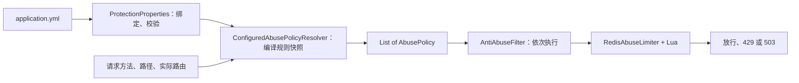

# 配置驱动防刷策略设计

日期：2026-10-18。对应当前网关代码：用“策略模式 + 配置驱动规则表”拆开规则声明、请求匹配和限流执行，新增接口保护时不再往过滤器添加 if/else。

## 1. 这次解决什么问题

原先 AntiAbuseFilter 同时知道注册路径、登录路径、五个服务名、配置字段和 Redis 执行顺序。每增加一个业务，就可能同时增加一个 properties 字段和一段业务分支。

现在分成四个职责：

| 组件 | 职责 | 新增普通接口策略时是否修改 |
|---|---|---|
| [ProtectionProperties](../shop-gateway/src/main/java/org/spring/shopgateway/config/ProtectionProperties.java) | 将 YAML 绑定成类型化配置，校验参数 | 否，所有专项规则使用同一种 PolicyRule 结构 |
| [AbusePolicyResolver](../shop-gateway/src/main/java/org/spring/shopgateway/protection/AbusePolicyResolver.java) | 定义“请求 → 有序策略列表”的接口 | 否 |
| [ConfiguredAbusePolicyResolver](../shop-gateway/src/main/java/org/spring/shopgateway/protection/ConfiguredAbusePolicyResolver.java) | 依据配置匹配方法、路径和路由，生成执行计划 | 否，只需增加 YAML 规则 |
| [AntiAbuseFilter](../shop-gateway/src/main/java/org/spring/shopgateway/protection/AntiAbuseFilter.java) | 依次执行计划，决定返回拒绝响应还是继续 chain | 否 |
| [RedisAbuseLimiter](../shop-gateway/src/main/java/org/spring/shopgateway/protection/RedisAbuseLimiter.java) | 执行单项策略的 Redis Lua 检查 | 否 |

解析器接口是策略模式的扩展点，当前使用配置实现。过滤器不依赖配置类，也不认识注册或登录路径。不同接口的差异作为规则数据表达，共享匹配逻辑。



新增一种完全不同的选择机制时，可实现 AbusePolicyResolver，并通过明确的 Bean 选择接入；普通接口增加额度配置不需要额外建一个 Java 类。

## 2. 当前配置写法

以下结构已经用于 [application.yml](../shop-gateway/src/main/resources/application.yml)：

```yaml
gateway:
  protection:
    anti-abuse:
      requests-per-window: 120
      window: 60s
      violations-before-ban: 3
      ban-duration: 5m
      redis-timeout: 1s
      key-prefix: gateway:abuse:v1
      policies:
        register:
          order: 10
          methods: [POST]
          paths: [/api/v1/users]
          limit: 5
        login:
          order: 20
          methods: [POST]
          paths: [/api/v1/auth/sessions]
          limit: 10
```

普通策略 all 始终先检查，其额度由 requests-per-window 控制。专项规则全部放在 policies 中，用策略名作为 Map 的键；无需再定义 registrationsPerWindow、loginsPerWindow 等逐业务字段。

## 3. PolicyRule 字段含义

| 字段 | 含义 | 默认/约束 |
|---|---|---|
| policies 下的名称 | 策略 ID，也参与 Redis 键摘要 | 1～64 位，以小写字母开头，后续允许小写字母、数字、下划线、连字符；all 为保留名 |
| limit | 当前 IP 在公共窗口内通过该策略的次数上限 | 必填，至少 1 |
| order | 专项策略执行优先级 | 默认 0，至少 0；数字小的先执行，同值按策略名排序 |
| methods | 适用的 HTTP 方法集合 | 省略或为空表示所有方法；使用 GET、POST 等合法大写方法 |
| paths | 路径模式列表 | 必填且至少一项，每项以 / 开头 |
| route-ids | 可选的实际网关路由 ID 集合 | 省略或为空表示不限路由；配置后精确匹配 |

匹配逻辑为：方法符合 **并且** 路由符合 **并且** 至少一个路径模式符合。同一字段里多个值表示任意一个符合即可。

路径使用 Spring PathPattern，例子包括 /api/v1/users、/api/v1/orders/*、/api/v1/orders/**、/api/v1/orders/{id}。其中 ** 表示任意层级后缀，应当位于模式末尾；/api/**/orders 这样的非法模式会在启动时失败。

注册默认仍为 5 次/60 秒，登录为 10 次/60 秒。所有规则当前共享 window、违规阈值、封禁时长和 Redis 超时，不在这次重构中新增逐规则算法参数。

## 4. 解析器每一步执行什么

### 4.1 启动阶段

1. Spring 绑定并校验 ProtectionProperties 和其中的 policies Map。
2. 解析器创建普通策略 AbusePolicy("all", requestsPerWindow)。
3. 按 order、策略名对专项规则排序。
4. compile() 检查保留名称，并用 PathPatternParser 编译路径模式。
5. 将匹配器和额度保存在不可变的 rules 快照中，供请求重复使用。

配置字段拼错、额度为 0、方法不合法、路径缺失或模式非法都会导致启动失败。ignoreUnknownFields=false 也会拒绝未迁移的旧字段，避免误以为旧配置仍在生效。

### 4.2 请求阶段

1. AntiAbuseFilter 从 exchange 读取可信 clientIp。
2. 调用 policyResolver.resolve(exchange)，过滤器不读取具体业务规则字段。
3. 解析器从 GATEWAY_ROUTE_ATTR 取得已经匹配的 Route，读取 routeId 和 lb:// 后的服务名。
4. requestPath() 使用 PathContainer 解析原始 HTTP 路径，分段解码一次，并按框架语义处理分号矩阵参数。
5. 如果首段是当前 lb 路由的服务名，移除该段用于规则判断；不再维护固定服务名名单，并去掉末尾斜杠。
6. 先加入 all，再遍历已排序的规则；每条规则命中一次就加入一个 AbusePolicy。
7. 过滤器将返回列表交给原有 concatMap，逐项执行 Redis 检查。

AbusePolicy 只有 name 和 limit，是一份执行指令，不包含 YAML 绑定、路径解析等细节。解析器只读取请求，不改写真正的转发路径；路由重写仍由网关原有过滤器负责。

### 4.3 多个匹配规则的行为

- 多个专项规则同时命中时全部叠加，不采用“只取第一条”或“后者覆盖前者”。
- 同一条规则的多个路径都命中时，该规则只执行一次。
- all 永远在最前面，不能通过专项规则的 order 把它移到后面。
- 执行时遇到第一个拒绝结果就停止后续检查，前面已经消费的额度不回滚。
- 没有命中任何专项规则时，仍检查 all。

## 5. 新增订单接口保护的操作方案

假设需要保护 POST /api/v1/orders，在现有 policies 下添加以下规则并重启网关：

```yaml
        create-order:
          order: 30
          methods: [POST]
          paths: [/api/v1/orders]
          limit: 20
```

此请求得到 [all/120, create-order/20]，仍使用公共 60 秒窗口。新增配置不需要修改过滤器、解析器、Redis 脚本或 properties 类字段。

若需要一条规则保护多个路径，直接在 paths 列表中声明；这些路径共用同一策略 ID 和 IP 额度。需要独立额度时使用不同的策略 ID。

route-ids 限制的是实际 Route.getId()，不是 Nacos 服务名。例如仅填写 shop-order-api，会只匹配该静态路由。发现入口还有自己的路由 ID，如果也要覆盖它，需要包含对应实际 ID；当前注册/登录规则没有限制 route-ids，因此静态入口和发现入口继续共用额度。

新增防刷规则不会替你新增业务路由或 Controller：应当先有可匹配的网关路由，才能进入 GlobalFilter；业务服务也仍需实现接口。

## 6. 老配置迁移及更新方式

| 原配置 | 新配置 |
|---|---|
| anti-abuse.registrations-per-window | anti-abuse.policies.register.limit |
| anti-abuse.logins-per-window | anti-abuse.policies.login.limit |
| AntiAbuseFilter 中的路径判断 | policies 下的 methods、paths、可选 route-ids |
| 过滤器中的 SERVICES 集合 | 从实际 lb 路由取得服务名 |

普通额度、窗口、封禁和超时字段继续使用原名。register/login/all 的策略名、Redis key-prefix 和计数算法保持一致，原有计数不因这次代码拆分主动清空。

修改已有策略的 limit 不会自动清空它之前的事件；改策略名则会进入另一组 Redis 键。因此名称应保持稳定，同一 Redis 上的所有网关实例应使用一致的策略配置。

当前是**启动时绑定、校验并编译**，修改本地 YAML 后重启网关生效。普通配置对象不是会自动变化的 Map；这次没有接入 Nacos Config 或自动热刷新。

后续若需要热更新，应在配置源变更后重新绑定、校验、编译一份完整快照，成功后原子替换解析器持有的快照；更新失败保留上一份有效规则。过滤器与 Redis 执行器不需要因此增加业务分支，但仍需实现并验证刷新接入。

## 7. 验证范围

- 规则绑定、方法匹配、顺序、重叠规则叠加、路由 ID 限制。
- 静态/发现入口、未来新增服务名、编码路径、尾斜杠及矩阵参数。
- 配置缺失、错别字、非法额度/方法/路径、保留名称和旧字段的启动拒绝。
- 通过测试配置增加 checkout 策略，真实 HTTP 请求会被新额度拦截，无需向过滤器增加分支。
- 原有 Sentinel、共享 Redis 并发额度、封禁、代理来源解析、路由转发及 Redis 故障响应继续回归。

最终执行 `mvn -o -ntp -pl shop-gateway -am test` 通过，共 37 项：common 1 项、gateway 36 项。其中策略解析与配置校验 17 项、真实 Redis 防刷 8 项，其余覆盖可信 IP、路由、Sentinel、依赖故障和启动。本次没有接入 Nacos 热更新，也没有改变 Redis Lua 算法。
