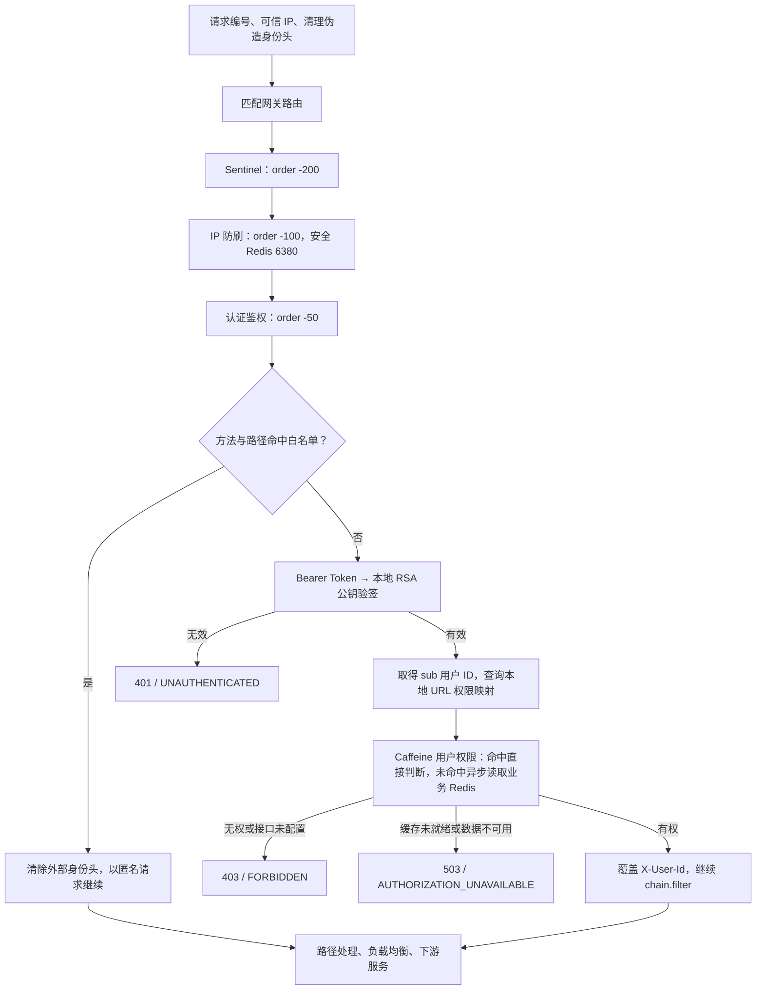

# 网关 JWT 与动态 RBAC 实现

> 历史实现：Caffeine、Pub/Sub 和本地规则快照已按新要求移除。当前 Redis 旁路缓存、OpenFeign 冷加载、数据库更新后失效及配置迁移，请阅读 [17 文档](17-Redis权限冷加载与OpenFeign.md)。本文保留之前方案和阶段验收记录，不能直接按旧缓存字段启动最新代码。

日期：2026-10-19。实现基于项目当前 Boot 3.2.5、WebFlux、Spring Cloud Gateway、Spring Security JOSE、Caffeine 3.1.8 和两个独立 Redis。没有改变已有 POM 继承层次，也没有引入 Servlet 安全过滤链。

## 1. 请求完整流程



认证使用 GlobalFilter，确保在已有防刷后执行。项目只引入 spring-security-oauth2-jose 来使用标准 JWT 解码器，没有启用会提前执行的默认 SecurityWebFilterChain。

白名单只跳过本过滤器的认证鉴权，仍经过前面的 Sentinel 和防刷。GlobalFilter 只覆盖匹配到网关路由的请求，新增管理端点或 Actuator 时应另外配置管理端口和访问控制。

### 1.1 外部请求与身份透传约定

前端访问受保护接口只需携带标准 `Authorization: Bearer <Token>` 和正常业务请求头、请求体；匿名白名单接口不要求 Token。不要求前端提供 X-User-Id、X-User-Roles、X-User-Permissions、X-Request-Id 或声明来源 IP 的代理头。客户端自行提交身份头时采用“删除后继续处理”，不因头存在而拒绝。

入口 `GatewayRequestFilter` 属于路由匹配前的 WebFilter。每次生成新 UUID，覆盖所有客户端 X-Request-Id，沿用已有 TRACE_ID 属性，不新增另一套 ID。预设响应头并在 beforeCommit 中恢复同一个 ID，避免下游同名响应头覆盖；统一拒绝响应的 body.traceId 仍从该属性读取。后续过滤器不重复生成编号。

IP 先从原始请求解析：默认采用 remoteAddress；仅直接对端属于配置的可信代理时，才解析受长度/跳数限制的 X-Forwarded-For，从右向左停在首个不可信节点，非法链回退连接对端。随后清除外部代理头并重建可信 X-Forwarded-For，最终 IP 存入 CLIENT_IP 属性供 6380 防刷使用。入口不读取或订阅业务请求体，保留 Authorization 和自定义业务头。

| 字段 | 原始请求（允许夹带伪造值） | 入口清洗后 | 认证鉴权通过后 |
|---|---|---|---|
| Authorization | Bearer Token | 原样保留 | 原样保留 |
| X-Request-Id | 可缺省；也可能客户端自填 | 网关新 UUID，与 TRACE_ID 一致 | 复用同一 UUID |
| X-Forwarded-For | 不可信的外部声明 | 依据可信代理规则解析后的 IP | 可信值继续传递；转发层可追加真实代理节点 |
| X-Real-IP / Forwarded / 其他外部 X-Forwarded-* | 可能存在 | 删除 | 不恢复外部值 |
| X-User-Id | 可伪造 | 删除 | 只写入验证所得 userId，单个值 |
| X-User-Roles / X-User-Permissions | 可伪造 | 删除 | 不注入 |
| 正常业务头、请求体 | 业务数据 | 保留，不消费请求体 | 保留 |

白名单在清洗后直接继续，不注入 X-User-Id。非白名单用验证所得的 userId 变量查询 Caffeine/6381 权限，绝不从请求身份头获取 RBAC 查询身份。任何拒绝分支停止转发；401、403、429、503 语义不变，下游异常不会被认证或防刷异常兜底误报。

## 2. 完整代码入口

| 文件 | 职责 |
|---|---|
| [GatewayRequestFilter](../shop-gateway/src/main/java/org/spring/shopgateway/web/GatewayRequestFilter.java) | 外部请求新 UUID、可信 IP、头清洗、响应提交前保留入口 ID |
| [GatewayRequestHeaders](../shop-gateway/src/main/java/org/spring/shopgateway/web/GatewayRequestHeaders.java) | 入口和认证共用身份头清理与请求头名称约定 |
| [AuthenticationAuthorizationFilter](../shop-gateway/src/main/java/org/spring/shopgateway/auth/AuthenticationAuthorizationFilter.java) | order=-50，白名单、Bearer 提取、认证鉴权、401/403/503、可信身份透传 |
| [JwtIdentityVerifier](../shop-gateway/src/main/java/org/spring/shopgateway/auth/JwtIdentityVerifier.java) | 响应式验签入口，将本地 RSA CPU 工作放在有界工作线程池 |
| [GatewayAuthConfiguration](../shop-gateway/src/main/java/org/spring/shopgateway/auth/GatewayAuthConfiguration.java) | 公钥加载、RS256 与 claims 校验、缓存和监听器装配 |
| [GatewayAuthProperties](../shop-gateway/src/main/java/org/spring/shopgateway/auth/GatewayAuthProperties.java) | 方法级白名单、签发方、受众、缓存和同步参数 |
| [GatewayRedisConfiguration](../shop-gateway/src/main/java/org/spring/shopgateway/config/GatewayRedisConfiguration.java) | 显式配置两套连接工厂与模板，防止自动配置退让或接错实例 |
| [BusinessRedisProperties](../shop-gateway/src/main/java/org/spring/shopgateway/config/BusinessRedisProperties.java) | 业务缓存实例独立连接参数 |
| [RbacModels](../shop-gateway/src/main/java/org/spring/shopgateway/auth/RbacModels.java) | 接口规则、用户权限、变更消息的数据契约 |
| [RbacCodec](../shop-gateway/src/main/java/org/spring/shopgateway/auth/RbacCodec.java) | JSON、Bean Validation、大小、规则 ID 和路径模式校验 |
| [RbacPermissionCache](../shop-gateway/src/main/java/org/spring/shopgateway/auth/RbacPermissionCache.java) | URL Caffeine、异步用户权限缓存、代际切换、在途撤权保护 |
| `RbacBroadcastListener`（已移除） | 历史方案中的业务 Redis Pub/Sub；当前方案不再注册此类 |
| [RbacRedisPublisher](../shop-gateway/src/main/java/org/spring/shopgateway/auth/RbacRedisPublisher.java) | 后台发布协议参考实现，异步 CAS 写入后广播 |
| [publish-rbac.lua](../shop-gateway/src/main/resources/redis/publish-rbac.lua) | 原子比较版本、更新权限缓存、发布通知 |
| [GatewayRequestPath](../shop-gateway/src/main/java/org/spring/shopgateway/web/GatewayRequestPath.java) | 防刷、白名单、权限规则共享路径语义，覆盖发现路由别名 |

网关继续引用 common 的 Result。GatewayResponses 新增不带 Retry-After 的重载供 401/403 使用；依赖错误返回 503 和 Retry-After: 1。

## 3. 两个 Redis 的连接边界

| 角色 | 连接工厂 Bean | 字符串模板 Bean | 默认地址 |
|---|---|---|---|
| IP 防刷 | redisConnectionFactory（Primary） | reactiveStringRedisTemplate（Primary） | 127.0.0.1:6380 |
| RBAC 缓存与广播 | businessRedisConnectionFactory | businessRedisTemplate | 127.0.0.1:6381 |

RedisAbuseLimiter 用 Qualifier 固定防刷模板；RBAC 缓存、发布器和消息监听器用 Qualifier 固定业务模板/工厂。常见的同宿主机同端口误配会被启动校验拒绝。两个逻辑 DB 不构成物理实例隔离。

防刷实例仍采用 noeviction，业务缓存实例仍采用 allkeys-lfu。本方案的权限是数据库的可重建派生缓存；业务 Redis 丢失权限文档后，网关返回 503，由后台从数据库重建，不能把缓存未命中当作用户有权。

## 4. JWT 身份契约

客户端发送单个 Authorization: Bearer 请求头。JWT 只携带身份和标准校验字段，例如：

```json
{
  "sub": "42",
  "iss": "flour-shop-user",
  "aud": "flour-shop-api",
  "iat": 1792346400,
  "exp": 1792347300
}
```

示例时间仅展示字段，实际 Token 应由签发方生成当前有效时间。代码固定信任配置的 RSA 公钥和 RS256，检查签名、exp/nbf、issuer、audience，以及正数 Long 范围的 sub。没有 exp 的 Token 被拒绝；包含 roles、permissions 或 authorities 的 Token 也被当前契约拒绝。

这是签名验证，JWT 内容本身可解码读取。网关不会从 Token 提取权限，不从 Token 的 URL 加载验证密钥，也不持有签发方私钥。

请求阶段没有文件 I/O。公钥只在启动时加载，RSA 验签通过有界工作线程池执行，避免占用 Netty I/O 线程。当前采用单公钥配置；生产密钥轮换需要安排旧 Token 有效期与新旧公钥兼容窗口，不能直接替换后认为旧 Token 仍可使用。

当前没有增加登录接口、refresh token、单 Token 注销或黑名单。JWT 是无状态身份凭据；禁用用户/撤销权限通过下面的 RBAC 数据更新生效。

## 5. 白名单配置

配置在 application.yml 的 gateway.auth.whitelist，按 HTTP 方法和规范路径匹配：

```yaml
gateway:
  auth:
    enabled: true
    whitelist:
      - methods: [POST]
        paths: [/api/v1/users, /api/v1/auth/sessions]
      - methods: [GET]
        paths: [/api/v1/products, /api/v1/products/**, /api/v1/categories, /api/v1/categories/**]
```

如后续实际路由采用 /login、/register，可以在这里配置相应方法与路径；白名单不会自动创建 Controller 或路由。

白名单只对匹配的方法开放，GET /api/v1/users 不因 POST 注册开放而自动匿名开放。路径解析沿用实际 lb 路由，支持 /shop-user/api/v1/users、一次编码、尾斜杠和 HTTP 矩阵参数。

入口及本过滤器均会清理 X-User-Id、X-User-Roles、X-User-Permissions。匿名请求不携带伪造身份；认证鉴权通过后，只设置验证所得的 X-User-Id，保留原始 Authorization 供下游验证。

业务服务不能仅凭可自行构造的请求头信任身份，应限制业务端口的直连访问，并验证原始 Token 或采用受认证的内部调用链。订单归属、租户范围等数据权限仍由业务服务校验。

## 6. Redis 权限数据契约

### 6.1 URL → 权限规则

默认 Key 为 shop:rbac:v1:rules，内容为一个带版本的完整规则集：

```json
{
  "version": "rules-v1",
  "rules": [
    {
      "id": "create-order",
      "endpoint": {"methods": ["POST"], "paths": ["/api/v1/orders"]},
      "routeIds": [],
      "permissions": ["order:create"],
      "match": "ALL"
    }
  ]
}
```

| 字段 | 意义 |
|---|---|
| version | 当前文档的发布版本，用于 CAS；建议使用数据库修订号或 UUID，每次变更使用新版本 |
| id | 规则标识，同一规则集内不能重复 |
| endpoint.methods / paths | HTTP 方法和路径模式，均至少一项 |
| routeIds | 可选实际路由 ID 精确限制，为空表示不限 |
| permissions | 所需权限码集合，不能留空 |
| match | ALL 要求拥有全部权限，ANY 要求拥有其中任意一项 |

多个规则同时命中时，需要通过全部命中规则，避免宽泛规则绕过更严格的规则。没有命中任何规则时返回 403。routeIds 一旦限制，需覆盖希望开放的静态/发现路由 ID；默认示例不限制，保持别名共用规则。

### 6.2 用户 → 权限

默认 Key 为 shop:rbac:v1:user:42：

```json
{
  "userId": "42",
  "version": "user-42-v1",
  "enabled": true,
  "permissions": ["order:create", "order:read:own"]
}
```

这些权限应由后台从 user_account → user_role → role → role_permission → permission 计算，并过滤禁用的账号、角色和权限。网关不直接连接 MySQL，也不接受前端提交的权限集合。

角色或角色权限变更时，应重算所有受影响用户的权限并发布用户更新；只刷新 URL 映射不能完成用户撤权。

enabled=false 或明确的空权限集合表示没有访问权限，返回 403。用户文档不存在、内容非法或键中 userId 与内容不符，视为缓存数据不可用，返回 503；不自动创建用户或授予默认权限。

两个文档都存业务缓存实例。数据库是权威来源，本次提供发布协议及网关消费实现，没有自动修改 user 服务的 RBAC 管理逻辑或安装数据库变更监听。

## 7. 后台更新与广播协议

Java 发布入口：

```java
// 新建文档的 expectedVersion 使用 null；修改时传入读取到的旧版本。
Mono<Long> updated = publisher.publishUser("user-42-v1",
    new RbacModels.UserGrant("42", "user-42-v2", true, Set.of("order:create")));
```

后台应在数据库事务提交后同步派生缓存，再广播；生产建议使用事务 Outbox/补偿重试，避免数据库提交成功而缓存更新永久失败。业务缓存被淘汰或重启丢失后，也应由后台重建。

发布 Lua 在同一次原子执行中完成：

1. 读取当前文档版本，比较 expectedVersion。
2. 拒绝旧版本并发覆盖；同一份完全相同的重试可以再次广播。
3. SET 新文档。
4. PUBLISH 变更事件到业务 Redis 的配置频道。

消息示例：

```json
{"type":"RULES","userId":null}
```

```json
{"type":"USER","userId":"42"}
```

消息只表示“缓存已变更”，不把权限内容作为更新补丁应用，因此延迟或重复通知不会重新授予旧权限。频道默认为 shop:rbac:v1:events，测试、预发、生产必须使用不同命名空间；Redis Pub/Sub 不按逻辑 DB 隔离频道。

规则变更清除规则快照和派生缓存后重新读取。用户变更保留 URL 编译结果，但替换整个用户缓存代际，确保旧 Future 不能把已撤销的权限写回。当前选择整代失效，适合管理端变更频率较低的场景；高频用户更新可进一步实现逐用户代际。

## 8. Caffeine、广播和一致性边界

- URL 缓存键包含方法、路径和路由 ID，最大 10000 项；路径模式在加载规则时编译。
- 用户权限使用 AsyncCache，同一用户的并发未命中合并为一次异步 Redis 读取。
- 客户端取消不会取消所有读者共享的 Future；失败 Future 精确移除，可再次加载。
- 授权决策完成前再次比较缓存代际，更新期间的旧读取返回 503，不按旧权限放行。
- SmartLifecycle 管理唯一监听订阅；先等待 SUBSCRIBE 确认，再执行首次同步。
- 异常断线会失效本地状态并退避重试；重建订阅时重新同步；周期读取用于校准。
- 默认每 10 秒校准规则，本地快照和用户权限最长缓存 30 秒；已知同步失败立即失效状态。

热缓存命中时，URL 映射和用户权限判断都在内存完成，没有 Redis 网络调用。RSA 验签仍需 CPU，因此这里不承诺整个请求严格为 0ms；冷缓存会等待一次非阻塞 Redis 读取，实际性能需按负载压测。

Redis Pub/Sub 是 at-most-once，不能保证断线期间的每条消息都送达。正常广播会触发实时失效；漏消息时，已经写入业务 Redis 的用户权限依靠 TTL 收敛，默认最多保留 30 秒旧缓存。数据库变更如果根本未同步到 Redis，不在这个时间保证内，必须由发布端可靠同步。

已经转发到业务服务的请求不会被一次撤权广播追回。对资金、发货等强一致操作，业务服务仍需在执行前检查实时权限/数据状态。

## 9. 本地启动与联调

从项目根目录执行，Java 使用 JDK 17：

```powershell
docker compose -f shop-gateway/compose.yaml up -d --wait
java infra/security/GenerateDevJwtKeys.java
```

本次已在本机生成开发密钥。生成器不会覆盖已有文件，文件位于 infra/local-secrets：公钥 jwt-public.pem、PKCS8 私钥 jwt-private.pem，目录由自身 .gitignore 排除。默认网关工作目录为 shop-gateway，只读取 ../infra/local-secrets/jwt-public.pem。

生产应通过 SHOP_GATEWAY_JWT_PUBLIC_KEY_LOCATION 提供签发方管理的公钥，私钥只属于签发方。infra/security 中的生成和签发工具只用于开发，不能当成登录认证服务。

发布内置开发样例需明确执行以下命令；**没有在本次实现中自动向正式命名空间写入用户权限**：

```powershell
./infra/security/Publish-DevRbac.ps1 -Type Rules -Document infra/security/examples/rbac-rules.json
./infra/security/Publish-DevRbac.ps1 -Type User -Document infra/security/examples/rbac-user-42.json
```

本地样例用户 42 只有 order:create 权限。工具使用业务缓存容器执行同一 Lua，以 Base64 参数传输 JSON，不把文档作为 shell 代码。它是受本机 Docker 访问权控制的开发工具，不是对外管理接口；正式后台应使用有数据校验的发布实现与访问控制。

如果文档已经存在，需要编辑样例 version 为新值，并通过 -ExpectedVersion 提供旧值，例如旧版本 dev-u1、新版本 dev-u2。不要直接用 SET 后忘记发通知，也不要通过清空 Redis 解决版本冲突。

生成开发 Token：

```powershell
$token = java infra/security/IssueDevJwt.java 42
Invoke-WebRequest -Method POST -Uri http://localhost:8888/api/v1/orders `
  -Headers @{ Authorization = "Bearer $token"; 'Content-Type' = 'application/json' } -Body '{}'
```

订单接口尚未实现时，授权通过后仍可能收到下游 404；这与网关认证失败不同。Token 工具默认签发 15 分钟有效的开发身份 Token，不包含角色和权限。已有正式登录系统时直接使用它签发的 Token。

网关默认开启认证。未初始化 RBAC 时，公开接口仍可访问，受保护接口在有效 JWT 下返回 503，防止空配置变成默认放行。原有只测试防刷的测试配置显式关闭认证；专用认证测试明确开启，并使用随机密钥与 Redis 前缀。

## 10. 配置参数速查

| 参数 | 默认值/含义 |
|---|---|
| gateway.auth.enabled | true，只有明确配置 false 才关闭认证过滤器 |
| public-key-location | 开发公钥路径，可用 file: 或 classpath: 资源 |
| issuer / audience | flour-shop-user / flour-shop-api，必须与签发方一致 |
| clock-skew | 30s 时钟容差，上限 2 分钟 |
| max-token-length | 8192 字符，限制 Authorization 长度 |
| cache-ttl | 30s，用户权限和本地快照最大有效期，上限 5 分钟 |
| resync-interval | 10s，必须小于 cache-ttl |
| redis-timeout | 1s，每次权限 Redis 操作的超时 |
| maximum-entries | 10000，本地 URL 和用户缓存各自的容量上限 |
| key-prefix / channel | shop:rbac:v1 / shop:rbac:v1:events |
| gateway.business-redis.host / port | SHOP_CACHE_REDIS_HOST / SHOP_CACHE_REDIS_PORT，默认 127.0.0.1:6381 |
| gateway.business-redis.password | SHOP_CACHE_REDIS_PASSWORD，默认本地开发口令 |
| gateway.business-redis.username / ssl | 可按部署配置 Redis 用户名与 TLS |

读取 isReady() 可用于对接部署平台 readiness；权限未加载或超时后应将受保护流量视为不可用。Caffeine 已启用统计，生产监控应纳入命中率、冷加载耗时、503、同步失败和广播连接状态。

## 11. 验证记录

2026-10-19 入口约定重构阶段，使用 JDK 17 执行 `mvn -o -ntp -pl shop-gateway -am package`，BUILD SUCCESS。当时共 60 项：common 1 项、gateway 59 项，失败 0、错误 0、跳过 0。该阶段的 target 临时日志已随后续 clean 清理；当前 Redis/Feign 的完整日志与 114 项验收见 [17 文档](17-Redis权限冷加载与OpenFeign.md)。在此之前还单独执行入口/IP 的 12 项针对性测试，全部通过；它们是当时完整回归的子集，不重复累计。

| 本次新增或调整的测试文件 | 验证内容 |
|---|---|
| [GatewayRequestFilterTests](../shop-gateway/src/test/java/org/spring/shopgateway/GatewayRequestFilterTests.java)，新增 4 项 | 合法/多值客户端 ID 被替换；attributes/转发头/响应头一致；响应提交时覆盖下游伪造 ID；混合大小写身份头清理；保留 Authorization、业务头、查询参数和请求体；可信代理先解析后清理；无客户端 ID 的不同请求生成不同 UUID |
| [ClientIpResolverTests](../shop-gateway/src/test/java/org/spring/shopgateway/ClientIpResolverTests.java)，新增 3 项 | 原 5 项继续验证直连与可信链；补查超过 2048 字符、超过 20 跳、非法链、多值头、无连接地址的回退行为 |
| [AuthenticationAuthorizationFilterTests](../shop-gateway/src/test/java/org/spring/shopgateway/auth/AuthenticationAuthorizationFilterTests.java)，新增 1 项 | RBAC 只查询验签所得 42，外部 999 不生效；后续 chain 真正抛出的异常原样传播，不转换成认证/权限依赖错误 |
| [GatewayAuthenticationTests](../shop-gateway/src/test/java/org/spring/shopgateway/GatewayAuthenticationTests.java)，加强现有 9 项 | 真实 HTTP：匿名无身份，角色/权限头被清理，有权时只注入单值验证身份；成功及 401/403/429/503/下游 502 均检查新 ID 和响应一致；拒绝不调用下游 |
| [GatewayAntiAbuseTests](../shop-gateway/src/test/java/org/spring/shopgateway/GatewayAntiAbuseTests.java)，加强现有 8 项 | 429 的 traceId 与响应头一致；变换伪造 IP 仍共享真实来源额度；转发 ID 与响应一致 |
| [RedisUnavailableTests](../shop-gateway/src/test/java/org/spring/shopgateway/RedisUnavailableTests.java) | 防刷依赖故障 503 同样带入口 ID 且不转发 |
| [HttpBackend](../shop-gateway/src/test/java/org/spring/shopgateway/HttpBackend.java)，测试辅助类 | 回显身份/角色/权限/请求体供断言，并故意发送不同响应 ID 验证入口覆盖；不改变业务代码 |

SentinelCapacityTests 继续验证真实 HTTP 容量拒绝、响应头/traceId 一致，以及下游调用数恰好等于放行数。6380、6381 使用现有 Docker Redis 实例，测试仍使用随机命名空间，只清理自身键；Nacos/控制台连接在测试中关闭，下游采用测试 HTTP 服务，不把此结果描述为真实业务服务联调或多机压测。静态检查确认生产代码未出现 block() 或 Thread.sleep()。

生产文件变更仅限：GatewayRequestFilter（新 ID 与提交前保留、入口清洗）、新增 GatewayRequestHeaders（共用头契约）、AuthenticationAuthorizationFilter（复用清理方法并明确已验签身份来源）、AntiAbuseFilter/GatewayResponses（修正流程与 ID 注释），application.yml 仅修正 Redis 职责注释。ClientIpResolver、Sentinel/JWT/RBAC 算法、双 Redis Bean 注入、所有 POM 与配置组织均继续复用现有实现。配套更新 11/12/16 文档、README 和 gateway-protection.http。

验证了默认用户/提前安全链没有被安装、IP 封禁优先于缺失 Token 的 401、两个独立监听器/缓存同步撤权、重订阅后读取最新数据，以及漏消息后 TTL 收敛。没有将本次测试描述为真实多机压测或严格 0ms 性能保证。

本地发布脚本、开发 Token 工具也已用随机命名空间验证，仅清理自身键；没有给默认命名空间自动授予用户权限，也未删除原防刷或业务数据。

依据：[Spring Security 响应式 JWT](https://docs.spring.io/spring-security/reference/reactive/oauth2/resource-server/jwt.html)、[Caffeine 异步加载](https://github.com/ben-manes/caffeine/wiki/Population)、[Redis Pub/Sub 投递语义](https://redis.io/docs/latest/develop/pubsub/)。
