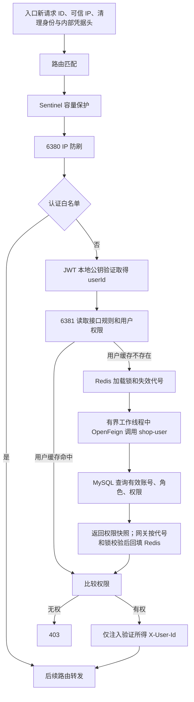

# Redis 权限冷加载与 OpenFeign

2026-10-30 安全迁移：静态内部凭据已被逐请求内部 JWT 替代，下游请求统一验签，直连注册/登录也需内部凭据。旧阶段代码说明以 [24 文档](24-网关内部JWT与下游统一验签.md) 为准。
日期：2026-10-20。加载锁已替换为 Redisson。本篇替代 16 文档中的 Caffeine、权限 Pub/Sub 和本地规则快照方案。保留现有 JWT 验签、Sentinel、IP 防刷、统一响应、POM 继承和配置文件位置。

认证编排和异常出口后续已拆分为 GatewayAccessService/PermissionAuthorizer/GatewayErrorWebExceptionHandler，纯权限比较移入 RbacPolicyEvaluator；Redis、Redisson、Feign 和失效协议不变。当前职责边界与 CORS/追踪建议见 [19 文档](19-网关职责重构与生产治理.md)。

## 1. 当前请求流程



没有 Caffeine、进程内用户权限集合、定时规则快照或权限广播监听器。每次受保护鉴权都读取业务 Redis。路径规则只在本次请求解析、匹配；规则更新后无需通知其他网关。

## 2. 读取入口和代码

| 文件 | 职责 |
|---|---|
| [AuthenticationAuthorizationFilter](../shop-gateway/src/main/java/org/spring/shopgateway/auth/AuthenticationAuthorizationFilter.java) | 沿用 order=-50；白名单、JWT、RBAC、身份透传；把原请求 ID 交给内部调用 |
| [RbacPermissionCache](../shop-gateway/src/main/java/org/spring/shopgateway/auth/RbacPermissionCache.java) | 仅 Redis 缓存、规则匹配、冷加载、跨网关加载锁、回填竞态防护 |
| [UserPermissionClient](../shop-gateway/src/main/java/org/spring/shopgateway/auth/UserPermissionClient.java) | OpenFeign GET 内部权限接口；默认按 shop-user 服务名发现 |
| [PermissionFeignConfiguration](../shop-gateway/src/main/java/org/spring/shopgateway/auth/PermissionFeignConfiguration.java) | Feign 连接/读取超时、不重试、不记录凭据、WebFlux 下显式 Jackson 解码 |
| [GatewayAuthConfiguration](../shop-gateway/src/main/java/org/spring/shopgateway/auth/GatewayAuthConfiguration.java) | 公钥、验签线程、Feign 有界线程、缓存装配；Feign 延迟注入避免启动循环依赖 |
| [UserPermissionSnapshot](../shop-common/src/main/java/org/spring/shopcommon/auth/UserPermissionSnapshot.java) | 两服务共用权限查询契约 |
| [PermissionCacheKeys](../shop-common/src/main/java/org/spring/shopcommon/auth/PermissionCacheKeys.java) | 共用数据、代号、加载锁 Key 约定 |
| [InternalPermissionController](../shop-user/src/main/java/org/spring/shopuser/controller/InternalPermissionController.java) | 内部凭据校验，不对前端提供权限管理能力 |
| [UserPermissionService](../shop-user/src/main/java/org/spring/shopuser/service/UserPermissionService.java) | 只读可重复读事务查询用户状态和有效权限 |
| [PermissionMapper.xml](../shop-user/src/main/resources/mapper/PermissionMapper.xml) | user_account → user_role → role → role_permission → permission 联表去重，过滤禁用数据 |
| [PermissionCacheInvalidator](../shop-user/src/main/java/org/spring/shopuser/service/PermissionCacheInvalidator.java) | 数据库事务写失效 outbox、提交后删缓存、失败退避重试 |
| [V3 迁移](../shop-user/src/main/resources/db/migration/V3__permission_cache_invalidation_outbox.sql) | 新增失效任务表，原 V1/V2 不改写 |

## 3. Redis 存储

全部 RBAC 数据只进入 6381。6380 仍由明确 Qualifier 绑定的防刷模板使用。用户服务仅配置 6381，同步 Redis 操作发生在 MVC 请求/后台任务线程。

| Key 示例 | Redis 类型 | 有效期与用途 |
|---|---|---|
| shop:rbac:v1:rules | String JSON | 完整接口权限规则，不设置 TTL；通过受控发布替换，每次鉴权重新读取 |
| shop:rbac:v1:user:{42} | String JSON | 用户有效权限，默认 30 秒 TTL；失效后经 Feign 冷加载 |
| shop:rbac:v1:user:{42}:epoch | String 随机 UUID | 失效代号，不设置 TTL；淘汰/重启后重新生成不同代号，防止旧回填 |
| shop:rbac:v1:user:{42}:lock | Redisson Hash，字段为 clientId:逻辑归属ID，值为重入计数 | 默认 5 秒租期（load-timeout + 1 秒），合并跨实例并发加载 |

花括号使同一用户的三个键同槽；当前连接仍为独立 Redis 单节点配置，没有因此自动启用 Cluster 或主备。

用户 JSON 继续使用 UserGrant 契约：userId、version、enabled、permissions。冷加载后的 version 是该缓存文档的新 UUID，不是数据库的全局单调版本；竞态防护使用单独的 epoch。

接口规则继续使用 [rbac-rules.json](../infra/security/examples/rbac-rules.json) 的 RuleSet：version、rules；每条规则包含方法、路径、可选 routeIds、权限集合和 ALL/ANY。多个匹配规则全部满足才放行，未配置的受保护接口默认 403。规则未初始化时返回 503，不自动开放所有接口。

## 4. 冷加载和非阻塞边界

每次请求先读规则。接口无规则直接 403；有规则则读取用户缓存。只有 GET 正常完成但 Key 不存在，才尝试冷加载。Redis 连接故障、超时或损坏 JSON 返回 503，不把依赖故障误当作缓存未命中冲击数据库。

冷加载者使用 Redisson 3.52.0 的 RLockReactive.tryLock(0, leaseMillis, MILLISECONDS, ownerId) 取得加载锁，随后再次读用户缓存，避免其他实例刚填好时重复调用。未获得锁的请求以 Mono.delay(25ms) 异步等待并重查，整个用户加载受 load-timeout 限制。锁按用户区分，不会把所有用户请求串行化。

businessRedissonClient 在 GatewayAuthConfiguration 中显式创建，只读取 gateway.business-redis 的配置，连接 6381；使用 Redisson core，不引入 Starter，不覆盖既有两个 Lettuce 模板。每次竞争通过 JVM 共享 AtomicLong 分配独立逻辑归属 ID，加锁与解锁始终传递相同 ID。不能使用 Thread.currentThread().getId() 作为响应式请求的身份：一个 Netty/并行线程可能服务多个请求，且同一请求会切换线程。显式指定租期，不启用 watchdog 续期；请求取消、客户端进程退出、加锁响应丢失等情况下仍有有限 TTL 兜底。

OpenFeign 是阻塞客户端。调用通过 Mono.fromCallable(...).subscribeOn(permissionFeignScheduler) 执行，默认最多 16 个工作线程、每线程有界队列；不调用 block()，不占用 Netty I/O 线程。Feign 连接超时 1 秒、读取超时 1.5 秒，关闭自动重试和请求日志，不跟随重定向；总用户加载默认 4 秒，包括锁等待和 Redis 往返。Feign 使用 Spring Cloud BOM 管理的版本，默认通过 Nacos/LoadBalancer 查找 shop-user。

Feign 返回正常且用户 ID 匹配后，网关把权限回填 Redis；Lua 在同一次执行中检查 epoch 和 Redisson Hash 的 clientId:ownerId 字段仍存在，再保存带 TTL 的缓存。不能先 isHeldByThread 再单独 SET，否则检查后锁到期的窗口会允许旧数据回填。当前 Hash 字段约定对应固定的 Redisson 3.52.0，升级版本须同时验证回填脚本和锁归属测试。读取期间发生失效或失去锁，旧结果不写缓存，也不用于此次放行，返回 503 重试。Mono.usingWhen 在正常、异常和取消时调用 lock.unlock(ownerId)，不手工删除锁、不使用 forceUnlock；释放失败还有租期兜底。

共用 Lua 位于 [shop-common 的 redis 目录](../shop-common/src/main/resources/redis)：rbac-user-epoch.lua、rbac-user-fill.lua、rbac-user-invalidate.lua。原自定义解锁脚本已删除，加锁/解锁交给 Redisson。首次从旧 String 锁升级时停止旧网关，等旧租期结束（默认 5 秒）后启动新版本，避免同名 Key 的类型冲突；不执行 FLUSHDB。

分布式锁主要处理缓存击穿：同一热点用户缓存失效时，只让一个加载者回源。不存在/禁用用户仍缓存 enabled=false 和空权限，减少重复无效查询；不同不存在 ID 的缓存穿透不能仅靠这把锁解决。6381 的 allkeys-lfu 可能提前淘汰锁，此时原子回填检查拒绝旧结果，但不能承诺整个部署在故障下始终只查询一次数据库；当前没有主备故障切换保证。

## 5. 内部接口

```http
GET /internal/v1/users/42/permissions
X-Internal-Token: <两个服务配置的同一内部凭据>
X-Trace-Id: <同一链路关联编号>
X-Request-Id: <同值兼容编号>
```

响应沿用 Result，data 示例：

```json
{"userId":"42","enabled":true,"permissions":["order:create","order:read:own"]}
```

不返回密码、用户实体或角色实体。不存在/禁用账号返回 enabled=false、空权限，可被短期缓存，网关返回 403。数据库故障或 Feign 非成功响应走 503，不能默认为有权。

缺失/错误内部凭据返回 403；非法用户 ID 返回 400。网关入口清理外部 X-Internal-Token，Feign 只添加配置凭据，不从客户端转发这个头。生产同时通过网络策略限制业务端口，使用 HTTPS/受保护的内部网络并替换本地凭据；这不是允许前端读取其他用户权限的公开接口。

## 6. 更新数据库后删除缓存

数据库是权限权威来源。未来的角色/账号权限写操作必须在同一数据库事务中调用：

```java
// 示例说明，不是本次新增的角色管理 API。
@Transactional
public void changeUserRoles(long userId) {
    // 修改 user_role 等数据库关系
    permissionCacheInvalidator.enqueueUser(userId);
}
```

enqueueUser 要求已有事务，写入 permission_cache_invalidation，与业务一起提交/回滚。事务回滚不删缓存；提交后立即尝试用 Lua 更换 epoch 并删除用户缓存。afterCommit 不再申请数据库连接，不让 Redis 故障把已提交的注册响应改成失败。

后台每秒扫描本命名空间到期任务，幂等失效后按 user_id/key_prefix/event_id 确认删除；失败递增 attempts，退避到最多 60 秒后继续重试。提交后的首次删除成功，worker 仍会再失效一次并确认任务，可能多一次冷加载，但不漏删。重复同用户任务合并；旧任务不能误确认并发产生的新事件。

当前注册事务在用户和默认角色关系写入后调用 enqueueUser，已完成接入。角色管理业务尚未扩展：改变角色权限时调用 enqueueRole(roleId) 失效所有相关用户；删除用户角色关系时，应记录原受影响用户并调用 enqueueUser，不能删除关系后才查询已经消失的关联。

直接手改数据库不自动产生任务；应在同事务写 outbox，或等待用户缓存 TTL。单纯 DEL 可以触发下一次冷加载，但应用中的失效应使用更换 epoch + DEL 的共用脚本，防止旧查询结果在删除后回填。

## 7. 启动与迁移

1. 启动原有双 Redis Compose 与 shop-user MySQL。Flyway 自动执行新增 V3，不需要删除已有表或数据库。
2. 两个服务使用相同 SHOP_INTERNAL_TOKEN、SHOP_CACHE_REDIS_HOST/PORT/PASSWORD。默认凭据仅用于本地开发。两个服务的权限 key-prefix 也必须一致。
3. 先启动 shop-user，再启动网关；默认 Feign 按 shop-user 服务名发现。SHOP_USER_INTERNAL_URL 可显式提供直连地址用于联调，留空则使用发现与负载均衡。
4. 初始化接口规则（首次创建；已有规则需要改版本并传 ExpectedVersion）：

```powershell
.\infra\security\Publish-DevRbac.ps1 -Type Rules -Document .\infra\security\examples\rbac-rules.json
```

不需要预先写用户权限文档：有效 JWT 的首次受保护请求会经 Feign 查询数据库后回填。已有用户可以继续使用；正式登录签发仍由业务后续实现，开发 Token 工具沿用 infra/security。

5. gateway.auth 移除 channel、resync-interval、maximum-entries，增加 load-timeout、feign-threads、user-service-url、internal-token。严格配置绑定会拒绝旧字段。cache-ttl 现在表示 Redis 用户权限 TTL，不再是本地缓存 TTL。

新用户缓存 Key 增加 `{用户ID}`，旧的无花括号用户文档不再读取。旧文档不会自动迁移成有效权限；新请求从数据库冷加载。不要 FLUSHDB 清理业务实例。原 rules Key 和 JWT/白名单约定不变。

## 8. 可用性与一致性边界

- 6380 故障仍是防刷 503；6381 故障是权限 503，不回源绕过 Redis。
- 用户服务故障时，已有 Redis 用户缓存可以在有效期内使用；缓存未命中或到期后依赖恢复，否则 503。
- 数据库提交与 Redis 失效之间仍存在短暂窗口；失效失败时依靠 outbox 重试和用户 TTL 收敛。已经完成鉴权的在途请求不能撤回，不宣称严格即时全局撤权。
- 回填锁减少并发未命中，不表示锁具备强一致选主能力；Redis 故障按不可用处理。
- 规则仍需受控发布和重建。业务 Redis 无持久化、使用 allkeys-lfu，被淘汰的用户数据可冷加载，被淘汰的 rules 文档需重新发布。
- 当前 Compose 两个 Redis 是职责隔离的单节点，不是互为主备。未部署 Redis Sentinel/Cluster、多机网关或 MySQL 主备，不能把本次重构描述为已经实现基础设施高可用。

## 9. 验证

2026-10-20 替换 Redisson 后执行：

```text
mvn -o -ntp -pl shop-gateway -am clean package
```

BUILD SUCCESS：shop-common 1 项、shop-gateway 67 项，共 68 项，失败/错误/跳过均为 0。日志：[redisson-tests.log](../target/redisson-tests.log)。本轮使用真实双 Redis 和实际 OpenFeign HTTP 测试服务；没有重新执行真实 shop-user/MySQL 的端到端脚本或主备切换测试。

新增三项真实 Redis 验证：两个独立 Redisson 客户端、40 并发只回源一次，Hash 加载锁只在业务实例且有租期；加载锁被替换后旧查询返回 503、不回填、不删除新所有者的锁；取消订阅后释放加载锁且不回填。既有热缓存、TTL、权限变更竞态、Feign 超时和网关认证/防刷/限流测试继续通过。

网关测试使用真实 6380/6381 Redis、实际 OpenFeign 和 SimpleDiscoveryClient 测试实例，覆盖正常冷加载、热读、跨对象并发合并、旧回填拒绝、服务错误/超时、无本地权限缓存及原入口身份约定。用户服务测试使用真实 MySQL/Flyway、6381 Redis，覆盖有效权限 SQL、内部接口、事务回滚、失效重试与角色影响范围。

2026-10-19 的原方案验证记录（当时尚未替换 Redisson）：实际执行 JDK 17 / Maven 离线干净构建：

```text
mvn -o -ntp -pl shop-gateway,shop-user -am clean package
```

BUILD SUCCESS，共 114 项：common 1、shop-user 49、shop-gateway 64；失败 0、错误 0、跳过 0。日志：[redis-feign-full-tests.log](../target/redis-feign-full-tests.log)。原有注册、异常处理、入口 ID/身份头、可信 IP、防刷、Sentinel 和路由测试继续通过。测试环境关闭 Nacos 自动注册，不依赖本机注册中心是否运行，生产配置不变。

新增或重写的核心验证包括：每次鉴权读取 Redis；实际 Feign 服务发现调用与同一请求 ID；40 个并发鉴权/两个缓存对象只回源一次；失效时旧查询不能回填；Redis TTL 到期后重新加载；Feign 503、超时和身份不匹配不缓存也不转发；阻塞 Feign 实际运行在专用工作线程。MySQL 测试覆盖有效关系去重、账号/角色/权限禁用、内部凭据、回滚不失效、提交后失效、Redis 故障下 outbox 保留及恢复重试、角色影响用户范围。

另外执行 [Test-RedisFeignFlow.ps1](../infra/security/Test-RedisFeignFlow.ps1)（PowerShell 7），启动本次打包的两个真实 Java 应用，使用真实 MySQL 和两台本地 Redis，验证：

1. 创建独立测试用户，数据库默认 USER 角色提供 order:create。
2. 网关通过实际 OpenFeign/LoadBalancer 调用真实 shop-user 的内部权限接口，查询 MySQL 并回填 Redis。
3. 请求进入真实 TestController，返回其设计的业务 400，证明授权通过而非网关错误放行。
4. 同事务删除该测试用户角色关系并写入失效 outbox，实际 worker 删除 Redis 缓存。
5. 下一次请求重新冷加载后返回 403，请求 ID 在响应头/体中保持一致。

结果：[result.json](../target/redis-feign-smoke/result.json)，各项均为 true。脚本只停止自己的临时进程，只清理自己的测试用户、角色关系、outbox 和 Redis 随机命名空间，不清理真实用户或执行 FLUSHDB。此项联调用 SimpleDiscoveryClient 映射测试服务地址，未启动真实 Nacos 集群，不描述为 Nacos 实机验收或多机压测。

可复现命令（先确保 JAR、Docker 依赖和本地开发密钥已准备）：

```powershell
.\infra\security\Test-RedisFeignFlow.ps1 -JavaHome 'D:/developjava/Java/jdk-17'
```

打包检查确认网关使用 Spring Cloud OpenFeign 4.1.1 / Feign 13.2.1，未包含 Caffeine JAR、旧广播监听类或 MySQL/MyBatis/Flyway/MVC 依赖。生产网关源代码未发现 block() 或 Thread.sleep()。没有部署或验证基础设施主备切换。

Redisson API 及脚本维护参考：[官方响应式锁说明](https://redisson.pro/docs/data-and-services/locks-and-synchronizers/)、[固定版本锁 Hash 实现](https://github.com/redisson/redisson/blob/redisson-3.52.0/redisson/src/main/java/org/redisson/RedissonLock.java)、[clientId:threadId 字段实现](https://github.com/redisson/redisson/blob/redisson-3.52.0/redisson/src/main/java/org/redisson/RedissonBaseLock.java)。业务代码使用独立逻辑 ID 作为 API 的 threadId 参数，不绑定实际线程。

2026-10-22 追踪接入更新：公共 Feign 拦截器自动从 MDC 写入两个同值头，网关冷加载隔离任务显式绑定/恢复 MDC；Servlet 接收与日志配置见 [21 文档](21-全链路TraceId与异步上下文.md)。
