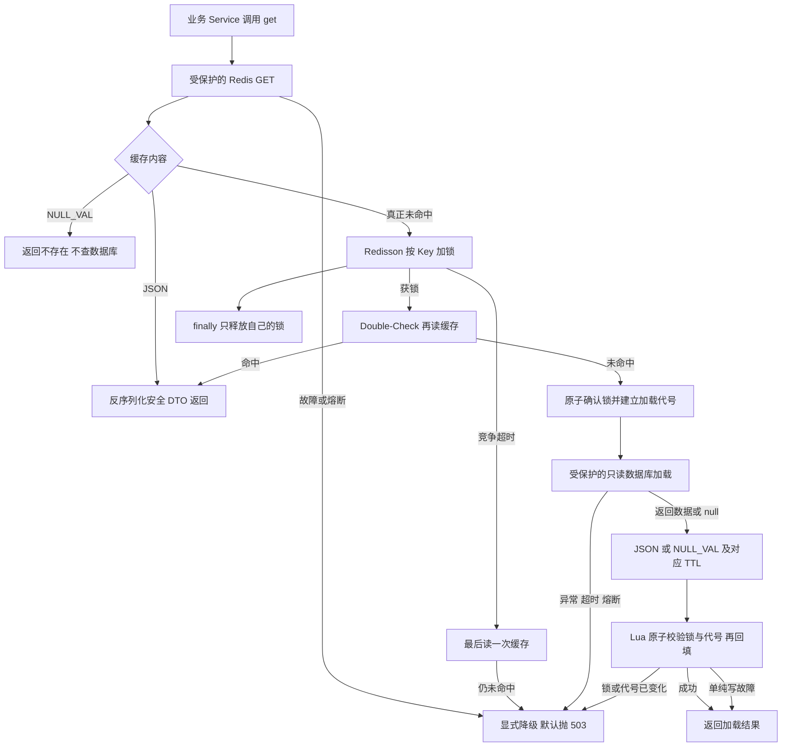

# SafeCacheTemplate 公共缓存组件

日期：2026-10-20。当前项目基线为 Java 17 / Spring Boot 3.2.5。组件位于独立普通 JAR `shop-cache`，继承 `shop-base-parent`，只在根 POM 增加聚合项，不改变其他模块的父子继承关系。Resilience4j 使用与现有 Spring Cloud 2023.0.1 BOM 一致的 2.1.0；Redisson 使用与网关一致的 3.52.0。

该组件用于 MVC 服务、后台任务的同步业务查询，不直接用于 WebFlux 网关线程。当前网关的 Sentinel/IP 防刷/JWT/响应式 RBAC、6380 防刷 Redis 及既有权限 outbox 均保持原实现；不要用这个普通数据缓存的降级结果授权用户。

## 1. 文件与职责

| 文件 | 作用 |
|---|---|
| [pom.xml](../shop-cache/pom.xml) | 按需 RedisTemplate、Redisson、Resilience4j Boot 3 依赖，产出普通 JAR |
| [SafeCacheTemplate](../shop-cache/src/main/java/org/spring/shopcache/SafeCacheTemplate.java) | 完整缓存模板：类型安全读取、NULL_VAL、双重检查锁、TTL 扰动、原子回填/失效、显式降级 |
| [CacheLoader](../shop-cache/src/main/java/org/spring/shopcache/CacheLoader.java) | Lambda 只读数据库加载函数，null 与失败分开表达 |
| [CacheDependencyExecutor](../shop-cache/src/main/java/org/spring/shopcache/CacheDependencyExecutor.java) | Redis 读/写及数据库读的重试、超时、熔断、工作线程隔离和 MDC 传递 |
| [SafeCacheAutoConfiguration](../shop-cache/src/main/java/org/spring/shopcache/SafeCacheAutoConfiguration.java) | opt-in 自动装配及连接/线程池生命周期；内部工厂不参与宿主 Redis 工厂自动选择 |
| [SafeCacheProperties](../shop-cache/src/main/java/org/spring/shopcache/SafeCacheProperties.java) | 缓存、锁、连接和有界池配置及参数校验 |
| [CacheUnavailableException](../shop-cache/src/main/java/org/spring/shopcache/CacheUnavailableException.java) | 依赖或保护拒绝，默认应映射 503，不能当作 404/空数据库结果 |
| [完整 application.yml 示例](../shop-cache/examples/application.yml) | 三个 Resilience4j 实例、Redis 连接、TTL、锁、线程池、MyBatis 查询超时 |
| [可编译业务 Service 示例](../shop-cache/src/test/java/org/spring/shopcache/example/UserProfileCacheService.java) | 构造器注入、Lambda 回源、只读事务查询 Bean、安全 DTO、事务后删除缓存 |

## 2. 接入业务服务

仅在需要同步缓存的服务 POM 加依赖。现有业务服务尚未自动引入本组件，避免改变已有接口行为。

```xml
<dependency>
    <groupId>com.dong</groupId>
    <artifactId>shop-cache</artifactId>
    <version>1.0-SNAPSHOT</version>
</dependency>
```

将 [examples/application.yml](../shop-cache/examples/application.yml) 中对应段落合并进服务自己的 `application.yml`。不要把示例文件作为同名配置放进依赖 JAR；组件不会自动覆盖宿主配置。启用开关是 `shop.cache.enabled=true`，默认 false：仅引入依赖不会启动本组件的连接或线程池。Resilience4j Starter 的 Registry 自动配置属于其正常依赖行为。

两个客户端都读取 `shop.cache.redis`，默认业务 Redis 6381；配置凭据通过环境变量覆盖。它不会复用 `@Primary` 防刷 Redis，也不依赖 Redisson Starter。当前只实现单节点地址配置，TLS/ACL/DB 配置会同时作用于 RedisTemplate 和 Redisson。`RedisResources` 对内部 Lettuce 工厂负责初始化/销毁，避免向容器再增加一个候选工厂导致宿主默认或响应式 Redis 自动配置歧义。

业务调用最小示例（`query` 是单独的 Spring Bean，其查询在数据库工作线程内进入事务）：

```java
@Service
public class UserProfileService {
    private final SafeCacheTemplate cache;
    private final UserProfileQuery query;

    public UserProfileService(SafeCacheTemplate cache, UserProfileQuery query) {
        this.cache = cache;
        this.query = query;
    }

    public UserProfileVO find(long userId) {
        if (userId <= 0) throw new IllegalArgumentException("userId must be positive");
        return cache.get("user-profile:v1:" + userId, UserProfileVO.class,
                () -> query.find(userId));
    }
}
```

`UserProfileQuery.find` 应是只读/幂等查询，由 Spring 代理在工作线程建立 `@Transactional(readOnly=true, timeout=1)` 事务。`UserProfileVO` 只包含 id/nickname 等允许缓存的数据，不直接使用含 passwordHash 的 `UserEntity`。完整可编译示例通过 `ProfileRepository` 边界接 Mapper，没有新增真实业务接口或表。

如业务允许明确的只读降级结果，可传第四个参数：

```java
return cache.get("shop-notice:v1", NoticeVO.class,
        noticeQuery::load,
        failure -> new NoticeVO("服务繁忙，请稍后刷新"));
```

降级函数在调用线程执行，应返回预先准备的常量或业务认可的快照，不重新查库、不发起无保护远程调用、不做业务写入。其返回值绝不写入缓存。默认不提供业务假数据，而是抛出 `CacheUnavailableException`，由宿主统一错误处理器映射成 503。确实不存在时 `get` 返回 null，由业务自己映射为 404。

泛型集合使用 `new TypeReference<List<UserProfileVO>>() {}` 重载，避免反序列化成无类型 Map。逻辑 Key 必须稳定并包含业务/结构版本，限制 1..512 个非空白字符；DTO/Key 契约改变时升级版本，避免同一物理 Key 被不同 Java 类型共享。

## 3. 每一步执行意义



1. Redis GET 成功且返回 null 才是 miss。连接故障、超时、熔断、损坏文档都走故障/降级，不直接绕过 Redis 查数据库。
2. 空缓存使用明确字符串 `NULL_VAL`，默认有效期 15 秒。真实业务字符串 `"NULL_VAL"` 使用 `JSON_V1:` 前缀编码，不会误判为空对象。查询异常从不写该标记。
3. 使用 Redisson `RLock.tryLock(wait, lease, MILLISECONDS)`。同步方法的调用线程持锁和解锁；等待最多由配置控制。未拿到锁后再读一次缓存，仍无数据则降级，不无锁回源。
4. 拿锁后再次 GET，避免之前 miss 的请求在等待期间已经被其他节点回填。锁按 Key 隔离，不把所有用户/商品串行化。
5. `BEGIN` Lua 校验 Redisson Hash 所有者字段并创建随机加载代号。代号只有有限租期，不产生永久的不存在 ID 记录。Redis 写不可用时不会继续访问数据库。
6. 只读 loader 在线程池执行，经过 Retry/CircuitBreaker/TimeLimiter。超时后模板不会继续回填，即使底层查询没有立即停止。
7. 正常值 TTL = `ttl + random(0..jitter)`，默认 5～6 分钟；负缓存使用独立较短 `null-ttl`。随机扰动打散正常过期点，不解决 Redis 整体停机或大量不同冷 Key 同时首次访问的问题。
8. `FILL` Lua 同时校验锁仍属于当前调用且代号未被主动失效删除，再写入带 TTL 的值。没有先检查再单独 SET 的竞态窗口。
9. 数据库成功后仅缓存写故障时，记录日志并返回真实数据库结果；明确锁丢失/失效代号变化时拒绝旧结果，走降级。降级返回值不回填。
10. `finally` 通过 `unlockAsync(ownerId)` 有限等待释放锁。锁不是自己持有则不解锁；异常解锁不会覆盖原始业务/依赖异常。不使用 `forceUnlock`，进程退出还有租期兜底。

## 4. 配置字段和保护顺序

完整可复制的配置见 [application.yml](../shop-cache/examples/application.yml)。Redis 读取、写入和数据库读分别使用固定实例名，不能按每个业务 Key 创建一个熔断器，否则会产生无界实例数量。

| 配置/实例 | 默认值 | 意义 |
|---|---|---|
| namespace | shop:cache:v1 | 环境、服务、数据结构版本隔离，不要与 RBAC 命名空间混用 |
| ttl / jitter | 5m / 60s | 正常值缓存 TTL = 基础 + 非负随机扰动 |
| null-ttl | 15s | 负缓存 TTL，不能超过正常 ttl；新建数据后要主动失效旧负缓存 |
| lock-wait / lock-lease | 1s / 10s | 竞争等待与持有租期；显式租期，不启用无限续期 |
| max-value-bytes | 262144 | 序列化结果上限，禁止大对象撑满缓存 |
| redis.timeout | 1s | 客户端连接/命令超时及解锁等待上限 |
| redis-pool | 8 threads / 32 queue（示例 64） | Redis I/O 隔离池，队列满立即拒绝 |
| database-pool | 8 threads / 32 queue | 数据库加载物理并发上限，应结合 Hikari 最大连接数设置 |
| safeCacheRedisRead | 每次尝试 250ms | Redis 读取保护 |
| safeCacheRedisWrite | 每次尝试 250ms | 加载代号、回填、删除保护，不拖垮热缓存读取 |
| safeCacheDatabase | 每次尝试 1500ms | 只读回源保护，独立于 Redis 故障统计 |

程序装饰顺序固定为 `Retry(CircuitBreaker(TimeLimiter(有界线程池任务)))`，使用程序式 API，不依赖注解 AOP、自调用或注解排列顺序。熔断器按每次尝试统计；最大重试次数 2 **包含首次调用**。默认只重试 Spring 瞬时数据访问异常、Redis 连接失败和 JDBC SQLTransientException。业务非法参数、超时、熔断拒绝、满队列拒绝、中断均不重试，避免慢查询/失败重试放大。

TimeLimiter 每次尝试的等待包含工作线程池排队；它不是整个 `get` 的总时限。一次 `get` 还包括多次 Redis 操作、锁等待、可能的重试间隔和解锁。禁止把本方法直接放进 WebFlux I/O 线程。若上游是响应式接口，应使用原有响应式方案或明确隔离整个同步调用。

TimeLimiter 使用真实 Future，超时 `cancel(true)`，并移除已取消的排队任务。JDBC/驱动可能忽略中断，仍需设置 JDBC socketTimeout、MyBatis statement timeout、事务超时、连接池 connectionTimeout。不要传播调用线程的 JDBC Connection；Spring 线程绑定事务不会自动跨线程，示例让独立查询 Bean 在实际工作线程新建事务。MDC 仅复制日志关联信息，并在任务结束恢复原上下文。

## 5. Redis 存储和主动更新

逻辑 Key 被 SHA-256 转为固定长度，物理 Key 形式如下；花括号用于多 Key Lua 同槽，当前连接仍是单节点，没有自动启用集群。

```text
<namespace>:{<sha256(logicalKey)>}:data        String: JSON_V1:<json> 或 NULL_VAL，带数据 TTL
<namespace>:{<sha256(logicalKey)>}:lock        Redisson Hash: clientId:threadId -> 重入数，有限租期
<namespace>:{<sha256(logicalKey)>}:generation  String: 随机加载 UUID，有限租期
```

业务更新应先提交数据库事务，然后执行 `cache.evict(logicalKey)`。该方法原子删除 data 和 generation，禁止旧查询继续回填；它不删除加载锁。失效调用失败必须由业务 outbox/后台重试兜底，不可吞异常后宣称删除成功。现有 RBAC outbox 有自己的协议和脚本，本组件不会自动覆盖。

数据库提交与缓存删除之间仍有短暂窗口，已经读取到旧缓存的在途请求也不能撤回。外部绕过 `evict` 只 DEL data，不能获得 generation 防旧回填能力。该组件提供最终一致的普通读取缓存，不宣称数据库/缓存之间具有强一致事务。

日志包含保护实例、重试次数、熔断状态变化、Key 哈希和根因类型；不会打印 JSON、SQL、凭据或原始业务 Key。宿主如果已有 Actuator/Prometheus，可通过 Resilience4j/Micrometer 接入监控；本模块不额外暴露管理 HTTP 端点。

## 6. 可用性与验证边界

缓存未命中时所有节点竞争同一个 Redis 锁；业务 Redis 的 `allkeys-lfu` 可能淘汰锁，租期到期和主备故障也可能产生重复回源，因此不能把它当成数据库唯一约束或交易锁。回填脚本仍会拒绝失去所有权的旧加载结果。Redisson Hash 字段约定按固定 3.52.0 版本验证，升级时须重跑锁/回填测试。

Redis 整体故障时默认显式降级，数据库不会因所有请求绕过锁而被打满；针对不存在数据的不同 Key 大量请求，仍须配合已有网关限流、参数校验，必要时另做准入过滤。当前未部署 Redis Sentinel/Cluster，也未实施数据库主备切换或性能容量压测。

测试使用真实业务 Redis 和独立 Redisson 客户端，数据库依赖由可控制的只读 loader 函数模拟，不代表已经接入真实业务表/完成 MySQL 故障演练。配置示例由集成测试直接导入，验证 Registry 名称和覆盖配置实际生效。测试只清理独立随机命名空间，不执行 FLUSHDB。

本次实际执行：

```text
mvn -o -ntp -pl shop-cache -am package
```

BUILD SUCCESS，22 项测试全部通过，失败/错误/跳过均为 0：保护层 7 项、默认关闭装配 1 项、真实 Redis 集成 14 项。日志：[safe-cache-tests.log](../target/safe-cache-tests.log)。产物：[shop-cache-1.0-SNAPSHOT.jar](../shop-cache/target/shop-cache-1.0-SNAPSHOT.jar)。Service 示例在 testCompile 阶段编译验证，不进入生产 JAR。

主要验证：跨两个独立 Redisson 客户端 24 并发只回源一次；负缓存和正常 TTL；JSON 字符串标记不碰撞及泛型类型；瞬时异常重试但业务错误/超时不重试；TimeLimiter 取消；线程池满拒绝、Redis/数据库隔离及 MDC 恢复；熔断拒绝/半开恢复；缓存写失败保留成功数据库结果；坏文档不回源；主动失效拒绝在途旧回填；锁竞争超时不绕过锁；慢查询忽略首次中断后晚返回仍不回填。没有本轮业务服务/MySQL 端到端或基础设施故障切换的通过声明。

官方参考：[Resilience4j Boot 配置](https://resilience4j.readme.io/docs/getting-started-3)、[TimeLimiter 的 Future 超时与取消](https://resilience4j.readme.io/docs/timeout)、[Redisson 锁与租期](https://redisson.pro/docs/data-and-services/locks-and-synchronizers/)。实现使用当前项目锁定版本，示例 YAML 以本项目实际测试为准。
