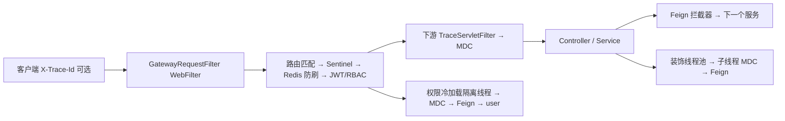

# 全链路 Trace ID 与异步上下文

2026-10-30 安全迁移：静态内部凭据已被逐请求内部 JWT 替代，下游请求统一验签，直连注册/登录也需内部凭据。旧阶段代码说明以 [24 文档](24-网关内部JWT与下游统一验签.md) 为准。
日期：2026-10-22。适用当前 Java 17 / Boot 3.2.5 / Gateway 4.1。实现 HTTP 请求的跨服务日志关联，复用现有入口和 Result，不引入 Collector、Span、Agent 或新的认证机制。

## 1. 唯一约定与实际执行链

| 位置 | 名称 | 含义 |
|---|---|---|
| 请求/响应头 | `X-Trace-Id` | 主追踪头，合法入站值可以延续 |
| 请求/响应头 | `X-Request-Id` | 同值兼容别名，避免破坏现有调用和前端读取 |
| JSON | `Result.traceId` | 和两个头一致，沿用原响应结构 |
| Servlet/Feign/异步日志 | MDC `traceId` | 当前执行线程的日志关联信息 |
| 网关响应式链 | Reactor Context `shop.traceId` | 订阅上下文中的值，通过自动桥接在回调执行期间绑定 MDC |
| 网关 | `GatewayRequestFilter.TRACE_ID` 属性 | 原有 exchange 属性键，供限流、鉴权和错误响应复用 |
| Servlet | `TraceContext.REQUEST_ATTRIBUTE` | 同一请求的 ASYNC/ERROR 再分派继续使用原 ID |



**保留早期 WebFilter，不再叠加一个生成 ID 的 GlobalFilter。** GlobalFilter 只在路由匹配后运行，单靠它不能覆盖无路由 404 和提前完成的 CORS 预检。原有 WebFilter(-2000) 负责所有进入应用处理链的请求，Sentinel(-200)、防刷(-100)、认证(-50) 仍是路由匹配后的另一层链，顺序不变。

### 入口值选择

网关：优先复用 exchange 已有值，否则采纳唯一且合法的 X-Trace-Id，否则生成新值。即使提供合法 X-Request-Id，也不能单独决定网关入口 ID。

Servlet：同一请求的重分派先复用 request attribute；新请求优先 X-Trace-Id。只有新头完全缺失时，才兼容以前内部调用的合法 X-Request-Id；新头非法时重新生成，不向旧头降级。

合法值为 `[A-Za-z0-9._-]{1,64}`，多值、逗号拼接、空白、换行、超长均重新生成。新生成值是 SecureRandom 的 8 字节随机数，编码为 **16 位十六进制**。它提供 64 位随机空间，是概率唯一的日志关联号，不作为数据库唯一约束或身份凭据，也不声称绝对不会碰撞。需要 W3C 标准的 128 位 Trace/Span 时，应单独迁移到完整观测 SDK。

客户端无需提交这两个头。允许客户端提供关联号意味着客户端可以重复使用它，日志系统不能把它当作鉴权、幂等、防刷或业务唯一键。

## 2. 文件与职责

| 文件 | 作用 |
|---|---|
| [TraceContext](../shop-common/src/main/java/org/spring/shopcommon/trace/TraceContext.java) | 常量、严格值校验、16 位生成、同步 MDC Scope |
| [TraceServletFilter](../shop-common/src/main/java/org/spring/shopcommon/trace/TraceServletFilter.java) | 全部 Servlet 请求及异步/错误分派的 MDC 绑定、请求头规范化、finally 清理 |
| [TraceFeignRequestInterceptor](../shop-common/src/main/java/org/spring/shopcommon/trace/TraceFeignRequestInterceptor.java) | 从 MDC 取值，覆盖并传递唯一的两个追踪头 |
| [MdcTaskDecorator](../shop-common/src/main/java/org/spring/shopcommon/trace/MdcTaskDecorator.java) | 提交时快照、执行时安装、结束后清理并恢复 |
| [TraceAutoConfiguration](../shop-common/src/main/java/org/spring/shopcommon/trace/TraceAutoConfiguration.java) | Boot 自动接入、最高优先级 Servlet Filter、有界业务异步池、可选 Feign 支持 |
| [TraceAsyncProperties](../shop-common/src/main/java/org/spring/shopcommon/trace/TraceAsyncProperties.java) | 按服务调整线程池参数 |
| [GatewayRequestFilter](../shop-gateway/src/main/java/org/spring/shopgateway/web/GatewayRequestFilter.java) | 复用原入口，解析 ID、规范头、响应提交前恢复两个头、写 Reactor Context |
| [TraceReactorConfiguration](../shop-gateway/src/main/java/org/spring/shopgateway/config/TraceReactorConfiguration.java) | 注册线程变量访问器，让 Reactor 安全绑定/恢复 MDC |
| [GatewayErrorWebExceptionHandler](../shop-gateway/src/main/java/org/spring/shopgateway/error/GatewayErrorWebExceptionHandler.java) | 外层异常出口显式恢复 Context，404/401/403/429/503 等继续使用同一个 ID |
| [RbacPermissionCache](../shop-gateway/src/main/java/org/spring/shopgateway/auth/RbacPermissionCache.java) | 原 Feign 冷加载任务的同步调用范围内绑定 MDC，不改变锁/缓存/权限规则 |
| [共享 Logback 配置](../shop-common/src/main/resources/org/spring/shopcommon/trace/logback-common.xml) | 控制台与滚动文件的同一日志格式 |

common 新增 `AutoConfiguration.imports`，通过 Boot 的自动配置发现，无需扩大组件扫描。四个骨架服务 product/cart/order/pay 只增加 common 依赖；父 POM 继承关系未变。user 原独立 RequestIdFilter 已删除，避免重复绑定/清理 MDC。Gateway 不加载 Servlet Filter/业务异步池，不引入 MVC 自动配置。

`context-propagation:1.1.1` 是 ThreadLocal 与响应式上下文的桥接库，并非 micrometer-tracing。`feign-core` 在 common 中声明 optional，仅已有 Feign 的应用自动注册拦截器；没有客户端的服务不被强制添加 OpenFeign Starter。

## 3. 网关 Context 为什么能写进日志

配置已加入 [gateway/application.yml](../shop-gateway/src/main/resources/application.yml)：

```yaml
spring:
  reactor:
    context-propagation: auto
```

入口使用 `Mono.defer(() -> chain.filter(next)).contextWrite(context -> context.put(TraceContext.REACTOR_KEY, id))`。Context 沿订阅传播，和执行线程不是一一对应。Micrometer ThreadLocalAccessor 将这个键映射到 MDC traceId；Reactor 自动模式负责每个回调前安装、结束后恢复，Context 没有键时清除 traceId。

因此 publishOn/subscribeOn 切换后，业务回调中的普通 `log.info(...)` 也能使用日志 Pattern。入口不能简单 MDC.put 后等异步结束再 MDC.clear：Netty 同一线程会交错处理多个请求。

统一异常处理位于 WebFilter 外层，不能假定入口 contextWrite 会覆盖外层错误订阅，因此错误处理器从 exchange 取同一 ID，再显式写自己的 Context。beforeCommit 最后将两个响应头恢复为入口值，防止下游覆盖。

现有阻塞 Feign 继续在 permissionFeignScheduler 有界池执行，任务内 `try (var ignored = TraceContext.open(requestId))` 为 Feign 拦截器明确提供 MDC，完成后恢复原值。没有新增 block() 或 Thread.sleep()。

## 4. Servlet、Feign 与清理

Servlet Filter 通过 FilterRegistrationBean 注册为 `Ordered.HIGHEST_PRECEDENCE`，覆盖 `/*` 和 REQUEST/ASYNC/ERROR。绑定前清理旧线程状态，将 ID 放入 MDC，设置两个响应头并规范后续读取的请求头。在 try-finally 中执行 chain，finally **MDC.clear()**，成功、异常或异步返回都不残留整份 MDC。

ASYNC/ERROR 再分派从请求属性恢复 ID，不重新生成。MVC Callable 使用配置的 applicationTaskExecutor，异步计算线程由 TaskDecorator 负责；原请求线程在返回容器时仍会清理。容器在同一栈内嵌套 ERROR 时，复用外层已经绑定的范围。

Feign 拦截器执行前删除模板中两个头的旧值，再将当前 MDC 的 ID 写入两个头，避免 header() 追加成多值。没有合法 MDC 时不传播模板残留值，也不假装已有请求链路。定时任务如果需要自己的关联号，可主动创建：

```java
try (var ignored = TraceContext.open(TraceContext.newId())) {
    // 这里的日志与同步 Feign 调用共享新关联号；退出恢复外层 traceId。
    client.call();
}
```

该拦截器不转发 Authorization/内部凭据；原权限客户端内部认证配置保持不变。以后新增业务 Feign 服务时，仍需自己引入 OpenFeign Starter 并启用对应客户端扫描。

## 5. 异步调用方式

Servlet 服务默认提供同一线程池的两个名称：`applicationTaskExecutor` / `traceTaskExecutor`。支持 MVC Callable、默认 @Async 和显式指定池的 CompletableFuture：

```java
@Service
public class AsyncOrderService {
    private final Executor executor;
    public AsyncOrderService(@Qualifier("traceTaskExecutor") Executor executor) {
        this.executor = executor;
    }

    public CompletableFuture<String> submit() {
        return CompletableFuture.supplyAsync(() -> {
            // 自动继承提交线程 MDC，内部调用普通 Feign 同样会带 traceId。
            return MDC.get("traceId");
        }, executor);
    }

    // 需由另一个 Spring Bean 调用本代理方法，this.audit() 不会触发 @Async。
    @Async("traceTaskExecutor")
    public CompletableFuture<Void> audit() {
        return CompletableFuture.completedFuture(null);
    }
}
```

配置写在各服务原有 application.yml/properties 中，不新增第二份应用配置：

```yaml
shop:
  trace:
    async:
      enabled: true
      core-pool-size: 4
      max-pool-size: 16
      queue-capacity: 256
      await-termination-seconds: 20
logging:
  file:
    path: logs
```

队列有界，满载抛拒绝异常，不静默丢任务。Spring 关闭时等待已有任务，等待期限按配置。已存在自定义 Executor 时公共池退让；在原 ThreadPoolTaskExecutor 上配置 `setTaskDecorator(mdcTaskDecorator)`，不要以为 common 会自动改造所有已存在的池。已有的 SafeCache 依赖执行器已经复制/恢复 MDC，本次保留。

TaskDecorator 捕获的是提交时的 Map 副本，任务运行前安装，finally 清除子线程修改并恢复执行前快照。恢复用于嵌套/同线程执行场景，不能在这种情况下清掉仍在工作的父线程状态。

**必须显式使用装饰池。** `CompletableFuture.supplyAsync(task)` 默认 commonPool、new Thread、parallelStream、自建 Executor、任意第三方回调及 DeferredResult 的生产线程不在该池的控制范围内；每个新增线程边界要接装饰器或显式绑定。thenApplyAsync 等后续异步阶段也要传同一受控 Executor；从一个没有上下文的外部线程提交任务，装饰器无法凭空恢复已丢失的 ID。不传播数据库连接或事务 ThreadLocal。

## 6. 日志与前端使用

六个实际服务均增加自己的 `logback-spring.xml`，显式 include common 共享资源，common 不放根 logback-spring.xml 抢占业务配置。格式包含：

```text
%d{yyyy-MM-dd HH:mm:ss.SSS} %-5level [服务名] [%thread] [%X{traceId:--}] %logger{48} - %msg%n
```

启动/后台无请求上下文时显示 `[-]`。控制台和文件一致，默认 `logs/<spring.application.name>.log`；每日/100MB 滚动，保留 14 天、总量 2GB。logging.file.path 可改目录；当前共享模板的文件名由服务名决定。重启应用后生效。

浏览器可以不带追踪头，遇到错误保存响应 X-Trace-Id 供日志检索。若要主动延续 ID，CORS 配置需允许 X-Trace-Id 并通过 exposed-headers 暴露它；现有 [governance 示例](../shop-gateway/examples/application-governance.yml) 已补充这两个配置，该示例仍需按原方式显式导入，不擅自修改生产来源名单。

```http
GET /api/v1/products
X-Trace-Id: demo-trace-20261022
```

向下游/响应 X-Trace-Id、X-Request-Id 及业务 Result.traceId 都为 demo-trace-20261022。空头或非法值会换成新 16 位值。正常业务响应仍由业务服务构造，不由网关重写 JSON。

本组件只解决日志关联，不生成 W3C traceparent，不记录 Span 时长/父子关系，也不证明 MQ、数据库后台线程已自动接入。未来安装完整 OTel/Micrometer Tracing 时，需要先统一 MDC traceId 的归属与 HTTP 契约，不能将 SDK 的标准 traceId 与这个短关联号相互覆盖。

## 7. 验证记录

测试覆盖：头优先级及唯一值、非法/超长/多值兜底、Servlet finally 整体清理、错误/异步重分派、@Async、CompletableFuture 与裸工作线程残留检查、真实 Feign HTTP、网关跨 Scheduler/80 并发隔离、错误和 CORS 响应、真实权限 Feign 追踪头。

实际执行 `mvn -o -ntp package -Dspring.cloud.nacos.discovery.enabled=false`：**BUILD SUCCESS**，共 **186 项，失败/错误/跳过均为 0**。common 12、cache 22、user 62、gateway 86、product/cart/order/pay 各 1。完整输出见 [全模块构建日志](../target/trace-full-build.log)。最后的公共装饰器按类型替换装配调整，另行重跑 common 12 项，见 [公共模块最终验证](../target/trace-common-final-tests.log)，并重新打包所有服务，见 [最终打包](../target/trace-final-package.log)。

执行 `./infra/security/Test-RedisFeignFlow.ps1 -JavaHome 'D:/developjava/Java/jdk-17'`，使用实际 user/gateway JAR、MySQL、6380/6381 Redis：经网关双 Token 登录刷新、Feign 权限冷加载、缓存失效、403、登出均通过；新增 **traceHeadersConsistent/gatewayMdcLog/userMdcLog/fileTraceLogs 均为 true**。不仅比较 HTTP 头与正文，还检查实际控制台日志及两个服务的滚动文件中出现同一 `[traceId]`。见 [真实验收结果](../target/redis-feign-smoke/result.json)。脚本会清理自己创建的测试数据并停止自己启动的服务。

Windows 的进程重定向日志保持写句柄，验收脚本通过 FileShare.ReadWrite 读取；初次日志核验遇到共享读取错误，修正后已完整重跑通过。每次执行会先移除旧验收 JSON，失败时不会遗留上一轮的 passed=true。

上述实际链路验收通过 SimpleDiscoveryClient 定位用户服务，没有验证 Nacos 故障恢复、生产压测、MQ 或观测后端。那些场景不属于本次已验证结果。

实现依据：[Reactor 上下文传播与自动模式](https://docs.spring.io/projectreactor/reactor-core/docs/current/reference/html/)、[Spring TaskDecorator/异步执行](https://docs.spring.io/spring-framework/reference/integration/scheduling.html)、[Spring Cloud OpenFeign 拦截器扩展](https://docs.spring.io/spring-cloud-openfeign/docs/current/reference/html/)。按项目固定版本编译测试，没有顺带升级框架。
